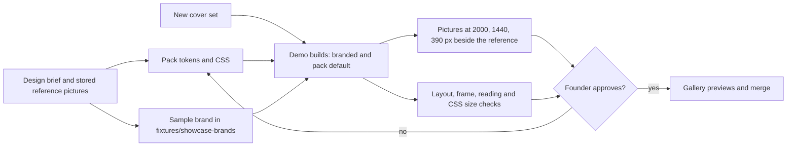

# Khalid template and demo design pass - Plan

**Target repo:** thebigasif/khalid

---

## Goal Capsule

- **Objective:** A visitor who opens the Khalid template gallery or any template demo, on an iMac, a laptop or a phone, sees a blog that looks made by a strong design team, as polished as the Ahrefs blog and as the reference blog named for that template. The founder can say yes to each demo from its pictures.
- **Means:** One design pass per template, each from its own written design brief, sample brand and reference blogs (KTD1, KTD2), judged by full-size pictures at 2000, 1440 and 390 px that the founder approves (KTD5).
- **Authority:** The founder's rules in `CLAUDE.md` come first, then `FRONTEND.md` and `docs/standards/performance.md`, then this plan. Where this plan disagrees with them, they win.
- **Stop conditions:** Stop and ask the founder when a template's design brief would change who the template is for, when a design needs a new page part or option, or when a template cannot fit its look inside the 20 KB stylesheet budget.
- **Execution profile:** Front-end work in CSS, pack tokens, demo fixtures and build scripts. Proof is pictures and the layout check, plus Rust tests where a unit changes Rust.
- **Who finishes and ships:** The Khalid CTO session builds and merges each unit. Its four build tracks started on 4 November 2026 adopt this plan as their checklist. A release that carries the new looks needs the founder's own "yes" in that session.

---

## Product Contract

### Summary

The ten Khalid templates other than Classic get a full design pass, and the demos and the gallery show each one at its best. Classic, the main demo's template, is redesigned separately in PR 952 and is not part of this plan.

### Problem Frame

On 4 November 2026 the founder opened https://thebigasif.github.io/khalid/demo/ on an iMac and said every template looks "made by an intern". Pictures at 2000 px (in the blog session's scratchpad, `khalid-shots/sheet.png`) show why:

- The main demo runs Classic with the stock tokens, so it shows blue underlined links and system fonts. PR 952 addresses this.
- Every template sits in a column of 800 to 1000 px in a 2000 px window, with small text and wide empty margins.
- The templates' palettes are close to each other. Keystone, Compass, Folio and Meridian set their colours and fonts inline in `crates/khalid-theme/src/<name>.rs`, and four of the five blues and indigos are near neighbours. Workbench sets only shape and type, so it keeps the stock colours.
- All 43 demo cover pictures (`cover.svg`, 37 English and 6 German) share one style: a soft purple drawing with pastel circles. So every demo looks alike and generic.
- Single faults: Ledger's post list is a stack of beige boxes, Compass's masthead is an empty grey card, Workbench's featured picture fills the screen.
- The layout check proves nothing overlaps at 390, 768 and 1440 px. It says nothing about whether a page looks good, and it never looks at a wide screen.

The demos are where people decide whether to use Khalid, and they are linked from serpdad.com/khalid, so this costs real users.

### Requirements

- R1. Each of the ten templates has a written design brief. It names who the template is for and two or three real reference blogs of that kind. It fixes the type pairing, colour palette, spacing rhythm, the minimum frame width at 1440 px and above, card and list style, the phone header and navigation, how tabs and indexes fit at 390 px, link, card and focus states, and two or three signature details.
- R2. Each template's demo looks distinct from every other one in the gallery. Someone shown two demo home pages side by side can tell them apart by more than the accent colour.
- R3. All ten templates have complete pack tokens (palette, font stacks, type scale and shape), so a blog that has not run theme sync still gets the designed look.
- R4. On wide screens (1440 to 2560 px) each template fills the frame its brief sets. Post pages have body text of at least 18 px and a reading column of 60 to 75 characters. No page shows a thin column alone in an empty screen.
- R5. On phones (320 to 430 px) each template is designed, not just squeezed: header, cards, lists and post pages keep the template's character and comfortable spacing.
- R6. The demo cover pictures are redrawn in one new style that suits every template's palette and does not look like stock art. Each post's picture shows what that post is about.
- R7. The template gallery page shows each template's real home page picture, its one-line purpose, and a link to the live demo, and itself meets the same standard.
- R8. A template is done only when the founder has approved its pictures at 2000, 1440 and 390 px: the branded demo, the pack default with no theme, and the reference blog of the same kind.
- R9. Nothing in `FRONTEND.md` regresses: contrast AA with the template's own tokens, 44 px touch targets, zero layout shift, no script needed, light theme only, each stylesheet under 20 KB compressed.
- R10. A blog that runs theme sync still gets its own colours and fonts on every template, and still looks good. The designs must not depend on the sample brand.

### Scope Boundaries

- Classic and the main `/khalid/demo/` page: PR 952.
- No new page parts, options or template names. Option defaults may change only where the design brief needs it, documented in `docs/templates/<name>.md`.
- No dark themes and no dark sections.
- The admin's Look screen is not changed.
- Author portraits, the logo and figures inside posts keep their current pictures.

#### Considered and not built

- A visual regression service that compares pictures automatically. Rejected: the bar is the founder's judgement of design quality, which pixel diffs cannot measure. Revisit if a later change breaks a look nobody noticed.
- Webfonts baked into the packs. Rejected: a pack is brand-neutral, and a customer's fonts come from theme sync. Sample webfonts go into the demo builds only (KTD2).
- A reusable cover generator or shape library. Rejected: the covers are redrawn once, and the approved cover sheet keeps the set coherent.
- Fetching reference blogs live in the picture script. Rejected: paywalls, consent banners and redesigns make live captures unstable. Reference pictures are captured once with each brief (U1).

#### Deferred to Follow-Up Work

- Redesigning the six example sites in `fixtures/examples/`.
- The SerpDad-branded demo copy at serpdad.com/khalid gets the new looks through the existing demos bundle, with no extra work. Any SerpDad-specific styling there is separate work.

### Success Criteria

- The founder says yes to all ten templates, the covers and the gallery from their pictures.
- In a side-by-side review at 2000 px, each demo home page is judged at least as polished as the reference blog named in its brief and as the Ahrefs blog.

---

## Planning Contract

### Key Technical Decisions

- KTD1. **One design brief per template before any CSS.** Each brief lives in `docs/templates/<name>.md` under a new "Design" heading and fixes the decisions in R1. Briefs are reviewed as a batch so the ten looks are deliberately different. Starting references, for the implementer to confirm or replace:

| Template | Kind of blog | Reference blogs | Direction |
|---|---|---|---|
| Almanac | Field guide of long guides | Stripe Press, Smashing Magazine guides | Warm paper, serif headings, numbered sections, generous margins |
| Atlas | Publication with many topics | The Verge, Ahrefs blog | Bold masthead, dense grid of picture cards, strong topic colour |
| Compass | Teaching blog | Ahrefs Academy, Backlinko guides | Friendly, clear steps, trail and key points as designed panels |
| Folio | Product team's notebook | Linear blog, Vercel blog | Precise, large type, ruled paper, quiet monochrome with one accent |
| Harbor | Busy marketing blog | HubSpot blog, Intercom blog | Bright, card-led, offers designed as part of the page |
| Keystone | Calm product or company blog | Stripe blog, Notion blog | Calm white frame, framed pictures, refined type |
| Ledger | Studies and long how-tos | Pew Research, Our World in Data | Text-led, ruled lists, data-friendly tables, no boxes around list items |
| Meridian | Company journal | Figma blog, Airbnb design journal | Editorial serif, wide rows, category tabs as a quiet index |
| Wire | News and columns | Search Engine Land, The Information | Newsroom density, strong rules, dated feed, kicker labels |
| Workbench | Tool reviews and comparisons | Wirecutter, Tom's Guide reviews | Exact, ruled, mono details, comparison tables as the hero |

- KTD2. **Every demo gets a sample brand, stored once and used by every build.** Each template's sample brand (palette, logo mark and one self-hosted font pair) lives in `fixtures/showcase-brands/<name>/theme/` as a `tokens.toml` and a `fonts/` folder. One shared step copies it over the showcase's `theme/`, and `scripts/pages.sh`, `scripts/layout-check.sh` and the U2 picture script all call that step, so what the founder approves is what the checks test and what Pages serves. Every font entry carries the `metrics` theme sync measures (`crates/khalid-theme/src/font_files.rs`), so the renderer writes a tuned fallback and the page does not shift. An entry without metrics is not allowed. The pack's own tokens (R3) use system font stacks chosen to match the brief and never include the sample brand.
- KTD3. **Width and type are set per template, not globally.** Each pack sets its frame (`--wide`/`--frame`) and type scale in its own tokens and CSS. Meridian's `--frame: 72rem` and Folio's `--wide: 76rem` are the existing pattern. A shared wide-screen rule in the base CSS would make the templates more alike, which works against R2.
- KTD4. **One new cover style for the 43 demo covers.** Flat editorial line drawings: ink lines on a light neutral ground, one accent area per picture, each showing its post's subject. Neutral grounds let one set suit every palette (R6). Pictures stay SVG.
- KTD5. **A picture review joins the layout check.** `scripts/layout-check.sh` gains 2000 px, a frame-fill check, a post-page reading check and a per-pack stylesheet size check (U2). A picture script saves full-page home, post and list pictures for each template at 2000, 1440 and 390 px, branded and pack-default, beside the stored reference pictures. These pictures are what the founder approves (R8). The automatic checks stay as the floor.
- KTD6. **Order: the weakest first.** Workbench (no colours of its own), then Keystone (serpdad.com/blog runs it), Compass, Folio and Meridian, then Ledger, then Almanac, Atlas, Harbor and Wire.

### High-Level Technical Design

### Assumptions

- PR 952 (Classic) changes shared base CSS. Template work is approved only on top of it (see Sequencing).
- The 20 KB budget leaves room: today each template's stylesheet is 10.9 to 14.1 KB compressed (measured 4 November 2026 from the live demos).
- The CTO session's four build tracks, already running, fold their work into this plan's units rather than starting over. Work that already meets a unit's checks counts.

### Sequencing

1. U1, U2 and the U6 sample covers start together.
2. PR 952 merges, and U6 lands the full cover set.
3. Then U3, U4 and U5 submit picture sheets for approval, one template per pull request, in the KTD6 order. Templates may be built in parallel before this point, but no sheet goes to the founder before step 2 is done.
4. U7 comes last.

If the shared base CSS changes after a template is approved, its pictures are taken again and the founder approves them again.

---

## Implementation Units

### U1. Design briefs, reference pictures and sample brands

**Goal:** Write the ten design briefs (KTD1), capture the reference pictures, and make each demo's sample brand (KTD2), reviewed together so the looks differ.

**Requirements:** R1, R2

**Dependencies:** None

**Files:**
- Modify: `docs/templates/almanac.md`, `atlas.md`, `compass.md`, `folio.md`, `harbor.md`, `keystone.md`, `ledger.md`, `meridian.md`, `wire.md`, `workbench.md` (each in `docs/templates/`)
- Create: `fixtures/showcase-brands/<name>/theme/tokens.toml` and `fonts/` for each template
- Create: the stored reference pictures beside the briefs

**Approach:**
1. For each template, capture its reference blogs by hand at 2000, 1440 and 390 px and note what makes them look professional: type sizes, frame width, spacing, how cards and lists are drawn.
2. Write the "Design" section with every field in R1.
3. Make the sample brand, with font metrics (KTD2).
4. Lay the ten palettes and type pairings side by side and change any two that are too close.

**Patterns to follow:** The existing structure of `docs/templates/keystone.md`. A theme-synced site's `theme/tokens.toml` for the brand file shape.

**Test expectation:** none, documentation and fixtures only. `crates/khalid-theme/tests/pack_docs.rs` must still pass.

**Verification:** One page shows all ten palettes and type pairings side by side, and no two look alike.

### U2. Picture review and the new layout checks

**Goal:** Make the founder's approval pictures easy to produce, and stop the checks from missing wide screens and oversized stylesheets (KTD5).

**Requirements:** R4, R8, R9

**Dependencies:** None

**Files:**
- Modify: `scripts/layout-check.sh`, `scripts/demo-check/layout.mjs`, `scripts/pages.sh`
- Create: the shared sample-brand step, and a picture script in `scripts/demo-check/`

**Approach:**
1. Add 2000 px to the layout check's default widths.
2. Frame-fill check on every page: at 1440 px and above, fail when the header and main frame are narrower than the minimum frame in the template's brief.
3. Reading check on post pages only: at 1440 px and above, fail when the body text is under 18 px or the reading column is under 60 or over 75 characters. Home and list pages are dense by design and are covered by step 2.
4. Size check: fail when any stylesheet a pack's built home page links is 20 KB or more with Brotli.
5. The sample-brand step (KTD2), called by `pages.sh`, the layout check and the picture script.
6. The picture script writes a sheet per template: branded demo, pack default and stored reference at each width.

**Patterns to follow:** The existing checks and options in `scripts/demo-check/layout.mjs`.

**Test scenarios:**
- Today's Keystone demo at 2000 px fails the frame-fill check, and a page whose frame meets its brief passes.
- A post with a 17 px body, or an 80-character column, fails the reading check at 1440 px. A list page with narrow cards does not.
- A stylesheet of 20 KB or more with Brotli fails the size check.
- A run with `--widths 2000` checks only that width.

**Verification:** The frame-fill check fails on at least three of today's demos at 2000 px and passes after their redesign.

### U3. Workbench, Keystone, Compass, Folio and Meridian

**Goal:** Redesign the five templates whose tokens are inline, one pull request each.

**Requirements:** R2, R3, R4, R5, R9, R10

**Dependencies:** U1, U2. Approval also needs PR 952 and U6 (see Sequencing).

**Files (per template `<name>`):**
- Create: `crates/khalid-theme/packs/<name>/tokens.toml`, moved from the inline `TOKENS` in `crates/khalid-theme/src/<name>.rs`
- Modify: `crates/khalid-theme/src/<name>.rs`, `crates/khalid-theme/packs/<name>/<name>.css`, and its `home.html` or `post.html` where the pack has them
- Test: `crates/khalid-theme/tests/packs.rs`, `crates/khalid-theme/tests/contrast.rs`

**Approach:**
1. Move the inline tokens into `packs/<name>/tokens.toml` and load them with `include_str!`, as `almanac.rs` does. Then set the values from the brief. Workbench gains a full palette.
2. Rework the pack CSS: frame and type scale (KTD3), header, cards, lists, post page, footer, then phone layout.
3. Fix each named fault: Compass's empty masthead card and Workbench's oversized featured picture.
4. Build the branded demo and the pack default, take the U2 pictures, and repeat until they hold up beside the reference.
5. Build once more with a different sample synced theme to prove R10.
6. For Keystone, also build with serpdad.com/blog's real theme and add those pictures to its sheet, since that live blog runs Keystone.

**Patterns to follow:** `crates/khalid-theme/src/almanac.rs` and `packs/almanac/tokens.toml` for tokens in a file. Meridian's `--frame` for wide frames.

**Test scenarios:**
- A new test in `contrast.rs` loads every pack's tokens from `packs()` and finds no pair below AA.
- The pack test still finds every option documented and every default allowed.
- The layout check, including the U2 checks, passes for the template at 320, 390, 768, 1440 and 2000 px in all three browsers.

**Verification:** The founder has approved the template's picture sheet.

### U4. Ledger

**Goal:** Redesign Ledger to its brief. Its list posts become ruled rows, not beige boxes.

**Requirements:** R2, R4, R5, R9, R10

**Dependencies:** U1, U2. Approval also needs PR 952 and U6.

**Files:** `crates/khalid-theme/packs/ledger/ledger.css`, `crates/khalid-theme/packs/ledger/tokens.toml`; test: `crates/khalid-theme/tests/ledger.rs`

**Approach:** As U3, steps 2, 4 and 5.

**Test scenarios:** As U3, plus the existing Ledger tests still pass.

**Verification:** The founder has approved Ledger's picture sheet.

### U5. Almanac, Atlas, Harbor and Wire

**Goal:** Bring the four templates that already have token files up to their briefs, one pull request each.

**Requirements:** R2, R4, R5, R9, R10

**Dependencies:** U1, U2. Approval also needs PR 952 and U6.

**Files (per template):** its `tokens.toml` and `.css` in `crates/khalid-theme/packs/<name>/`; tests as U3, plus `crates/khalid-theme/tests/atlas.rs` for Atlas

**Approach:** As U3, steps 2, 4 and 5.

**Test scenarios:** As U3.

**Verification:** The founder has approved each template's picture sheet.

### U6. New demo cover pictures

**Goal:** Replace the 43 demo covers with one coherent new set (KTD4).

**Requirements:** R6

**Dependencies:** U1 (the briefs show what the set must suit)

**Files:**
- Modify: every `cover.svg` under `fixtures/showcase-site/content/`

**Approach:**
1. Draw five sample covers and check them on three templates with different palettes before drawing the rest.
2. Draw the set, one picture per post subject. German posts reuse the matching English post's picture where the subject is the same.
3. Keep alt text in each post accurate to the new picture.

**Test scenarios:**
- Every post still has a cover, and the linter passes on the showcase site.
- The demo build's total picture weight does not grow.

**Verification:** The founder approves a sheet of all covers, and the covers look right on three templates.

### U7. The template gallery

**Goal:** Make the gallery page meet the same standard and show the new looks.

**Requirements:** R7

**Dependencies:** U3, U4, U5

**Files:** `site/content/en/pages/templates/`, `site/theme/site.css`, `scripts/template-previews.sh`

**Approach:**
1. Write a short brief for the gallery: the card grid at each width, the preview crop and size that keeps the design readable, the phone layout at 390 px, link and focus styles, and alt text for each preview.
2. Draw the previews at 1440 px instead of 1280 px so they show the wide-screen design.
3. Give each gallery card the template's purpose, its kind of blog and a clear link to the demo.

**Test expectation:** none, content and styling. Covered by the layout check and pictures.

**Verification:** The founder approves the gallery picture sheet.

---

## Verification Contract

- `just check` is green for any unit that touches Rust or pack tests.
- `just layout-check` passes for every changed template in Chromium, Firefox and WebKit at 320, 390, 768, 1440 and 2000 px, including the frame-fill, reading and stylesheet size checks from U2.
- The U2 picture sheet for each template is posted on its pull request, and the founder's approval is quoted there.
- After the Pages deploy, the live demo is checked at 2000 and 390 px in a real browser.

## Definition of Done

- All ten templates, the cover set and the gallery have founder-approved picture sheets.
- Every template has pack tokens in `packs/<name>/tokens.toml` and a "Design" section in its doc.
- All automatic checks are green and no budget has moved.
- Abandoned experiments, unused CSS and spare picture files are removed from each diff.
- The changelog fragment says, in plain words, that the templates were redesigned.
