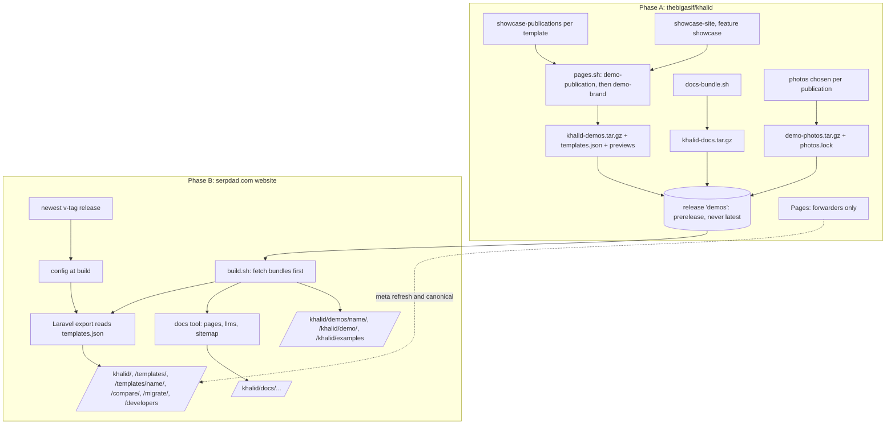
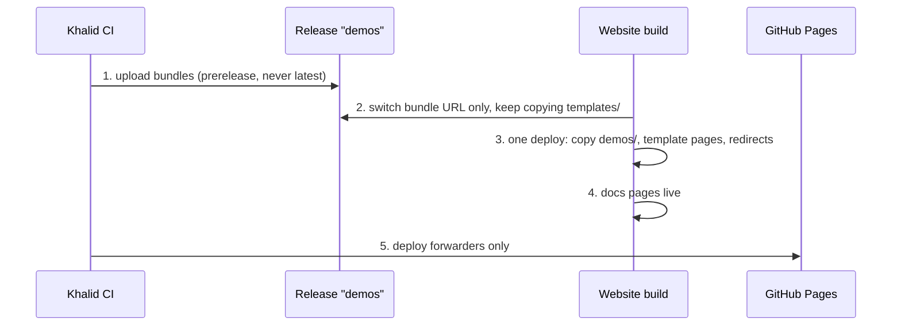

# Khalid against Ghost and Strapi, with serpdad.com as its home - Plan

**Target repos:** thebigasif/khalid (Phase A) and the SerpDad website, thebigasif/serpdad-website (Phase B). Paths are marked `khalid:` or `website:`.

This plan extends the template and demo design plan (`docs/plans/2026-11-04-1516-feat-template-demo-design-plan.md`, U1 to U7). Those units stay as written. Their layout work is done or with the founder: all ten templates are reviewed, three are approved, and one is merged. This plan adds U8 onward.

---

## Goal Capsule

- **Objective:** Someone choosing between Ghost, Strapi, WordPress and Khalid lands on serpdad.com/khalid. They see ten template demos that hold up next to Ghost's best paid themes, plus the Classic feature showcase. They understand in one screen why Khalid costs less to run, and they start a blog with the template they liked in one command. A developer coming from Strapi finds a headless path that works the same day.
- **Means:** Give each of the ten designed templates its own demo publication with real photographs and a named signature device (KTD2 to KTD5). Make serpdad.com the only home for the gallery, demos, comparisons, migration guides and docs, with GitHub Pages forwarding there (KTD6 to KTD9). Add `khalid init --template` (KTD10).
- **Authority:** The founder's rules in `CLAUDE.md` of each repository come first, then `FRONTEND.md`, `docs/standards/performance.md` and the website's `SitePagesTest` rules, then this plan.
- **Stop conditions:** Stop and ask the founder:
  - before publishing any comparison, migration or developer text;
  - before merging any template's publication to main, which happens at U11;
  - when a claim about Ghost or Strapi cannot be backed by their own current public page;
  - when a demo would need a new template feature to meet its brief.
- **Execution profile:** Two repositories in parallel, with many agents at once. Content and photography work fans out one agent per template. Website pages fan out one agent per page group. Every visual result is proven by full-size pictures at 2000, 1440 and 390 px, and every page by the existing test suites.
- **Who finishes and ships:** The Khalid CTO session lands Phase A in thebigasif/khalid. The blog session lands Phase B in the website repository. A Khalid release needs the founder's own "yes" in the CTO session. A website merge and deploy needs the founder's "Yes, merge and deploy".

---

## Product Contract

### Summary

Khalid already has strong engines: one binary, SEO and a writing linter built in, importers for WordPress, Ghost, Medium and Substack, a headless mode with a Content API in Ghost's query shape, and Astro and Next.js starter kits. What it lacks is the shop window. The demos all show the same blog with line drawings, so they read as "AI slop" next to Ghost's themes. The gallery and demos live on GitHub Pages instead of serpdad.com. And nothing on serpdad.com makes the case against Ghost or Strapi. This plan fixes all three, without a website builder.

### Problem Frame

Evidence gathered on 4 November 2026 (research dossiers listed under Sources):

- **The demos all show one blog.** All 11 template demos build from `khalid:fixtures/showcase-site`: the same "Larkspur Ledger", 36 English posts, 4 authors, and SVG drawings with no photographs. Side by side, the templates look like one site in ten outfits.
- **Ghost's best themes follow a clear recipe.** Eight top themes were measured (Proza, Aura, Splash, Kontur, Xpresiva, Break, Siwa, Feedora, $89 to $149 each):
  - each demo is a named publication with its own subject, invented editorial details and 10 to 25 coherent posts;
  - one display face is set at 60 to 108 px on a desktop with tight tracking, scaling to 36 to 40 px on a phone, over a reading face at 16 to 20 px;
  - micro-labels in small capitals or mono type;
  - one memorable signature device;
  - real photography;
  - a conversion layer on the demo itself.
- **serpdad.com is not the home.**
  - The README and `khalid:site/site.toml` send people to `thebigasif.github.io/khalid/`.
  - serpdad.com downloads the demo bundle from GitHub Pages at every deploy (`website:deploy/khalid-demos.sh`).
  - The landing page's structured data and Docker command still say version 1.1.1, hard-coded in `website:config/site.php`, while 1.3.2 is current.
  - GitHub Pages and serpdad.com serve the same gallery and demos, so the same pages live in two places.
- **The case for Khalid is nowhere on serpdad.com.**
  - There is no comparison with Ghost or Strapi, and no migration guide.
  - There is no developer page for the headless mode, and no Khalid docs.
  - Strapi is not mentioned anywhere.
- **The rivals' costs are Khalid's opening.**
  - Ghost(Pro) is $18, $29 or $199 a month, and the $18 plan allows only official themes. Self-hosted Ghost needs Node, MySQL 8, NGINX and Ghost-CLI.
  - Strapi Cloud is $35, $90 or $450 a month. Self-hosted Strapi needs Node and a database, and a blog on it needs a separate front end. Its only official starter is Next.js, with no Astro starter.
  - Khalid is one free binary with both starters.

### Requirements

**Templates that beat Ghost's**

- R1. Each of the ten designed templates has its own demo publication, and Classic keeps the feature showcase at /khalid/demo/. A publication has:
  - a name;
  - a subject suited to its template's brief;
  - 15 to 20 posts written for it;
  - 3 to 4 named authors;
  - invented editorial details;
  - its own menus, categories and call to action.

  No two publications share a subject.
- R2. Each demo uses real photographs, art-directed per publication (KTD4). Each photo's licence and credit are recorded.
- R3. Each template meets a written design bar against its primary Ghost pair (KTD3):
  - display type at the pair's measured scale and tracking on a desktop, and 36 to 44 px on a phone;
  - a reading face at 17 to 20 px;
  - its named signature device (KTD5);
  - the layout already approved in the first plan.

  Before a sheet goes out, the template's agent scores it against the KTD5 checklist and shows the result on the sheet.
- R4. The founder approves each template's new picture sheet, with its primary Ghost pair shown beside it, before its publication merges.

**serpdad.com as the only home**

- R5. serpdad.com/khalid/ holds:
  - the landing page;
  - the template gallery;
  - one page per template;
  - every live demo;
  - the comparison pages;
  - the migration guides;
  - the developer page;
  - the docs.
- R6. Every address under `thebigasif.github.io/khalid/` forwards to a serpdad.com address that answers 200, with a canonical link to it. The README, the Khalid site sources and the docs link to serpdad.com.
- R7. The Khalid version shown on serpdad.com always matches the newest `v` release. A build that cannot read it fails loudly instead of showing a stale number.

**Using a template, without a builder**

- R8. Each template page shows, in this order on every width:
  1. the template's name, the kind of blog it suits, and "Free, open source";
  2. the start command (`khalid init blog --template <name>`) with a copy button that also works as plain, selectable text without script, beside the link to its live demo, both above the fold at 390 px;
  3. its pictures (home, post, phone);
  4. what it shows on each page type;
  5. its options;
  6. links to the deploy guides.

  Only templates whose publication is ready appear in the gallery with their new demo. Until then a template shows its approved layout pictures and links its current demo.
- R9. `khalid init` takes `--template <name>` and writes that template into the new site's `site.toml`. An unknown name stops with the list of names.

**Making the case**

- R10. A comparison hub at /khalid/compare/ leads to Khalid vs Ghost, vs Strapi and vs WordPress. Each page has:
  - a yes/no table;
  - setup and running cost side by side;
  - "when to pick each", including when the rival is the better choice;
  - sources with the date each was read.

  Rival prices appear only on these pages.
- R11. Migration guides, one per source Khalid imports: WordPress and Ghost first, then Medium and Substack. Each covers export, `khalid import`, redirects and the checks after the move. Every command shown is run against the importer's fixtures before publishing.
- R12. A developer page for people coming from Strapi or Ghost. It covers:
  - the headless mode;
  - the Content API, with Ghost's query shape;
  - the Admin API;
  - webhooks;
  - MCP;
  - the Astro and Next.js starter kits, both built in CI.
- R13. Khalid's user docs (`getting-started`, `deploy` and its guides, `templates`, `routes`, `seo-settings`, `seo-tools`, `reading`, `newsletters` and `charts-embeds-tracking`) are published at /khalid/docs/ from the Khalid repository, so they stay one source. Each doc is in the sitemap and `llms-full.txt`.

**Quality floor**

- R14. Every new or changed page passes:
  - the website's `SitePagesTest` rules;
  - the Khalid layout check;
  - a real-browser check at 2000, 1440 and 390 px before its pull request is called done.

  Speed budgets are never raised.

### Scope Boundaries

- No website builder, page builder or theme editor. People pick a template and use it.
- No hosted Khalid and no paid theme marketplace.
- No Strapi importer. A Strapi blog's content can be exported as JSON and brought in through the `folder` importer. The Strapi migration guide says so honestly.
- Layouts approved in the first plan are not reopened. This plan changes demo content, photography, display type and signature devices only.
- Light theme only. Where a Ghost pair is dark (Proza, Break), the agent carries over its type and structure, not its darkness.

#### Considered and not built

- **A live font and palette switcher on demos (the Siwa pattern).** It needs script on public pages, which `FRONTEND.md` keeps to polish only. Revisit as one shared, script-optional part if visitors ask.
- **A buy or "use this template" bar inside every demo.** Each template page already does that job, so a single link back from the demo's announcement line is enough (U12). Revisit if the demos send few visitors back.
- **A per-template Cloudflare deploy button.** Khalid's Cloudflare kit deploys one fixed folder with no template setting, so a per-template button would need eleven deploy kits. Template pages link the deploy guide beside the start command instead. Revisit if the start command proves a barrier.
- **Rival theme prices on every template page.** They would be eleven claims to keep current. The comparison pages carry dated prices instead.
- **Generated photographs.** Rejected: generated images are what reads as "AI slop".

#### Deferred to Follow-Up Work

- **The shared home parts every template uses.** Topics, topic tabs, the video and podcast rows, the footer, and category rows that repeat the topic label. The CTO session tracks these as one shared follow-up.
- **"Khalid vs Substack" and "Khalid vs Medium" pages.**
- **A Strapi importer,** if Strapi users ask for one.

### Success Criteria

- The founder approves all ten new picture sheets beside their Ghost pairs, and judges each template at least as polished as its pair.
- No page under `thebigasif.github.io/khalid/` is the canonical address of anything. Search Console for serpdad.com lists the template, comparison and docs pages as indexed within four weeks of launch.
- A visitor can go from the serpdad.com gallery to a running local blog with the template they picked using only what the template page shows. This is checked end to end on Linux and macOS.

---

## Planning Contract

### Key Technical Decisions

- KTD1. **One plan, two repositories, two owners.**
  - **Phase A,** in thebigasif/khalid, belongs to the Khalid CTO session: demo publications, display type, the bundles, GitHub Pages forwarding, `init --template`, and the starter-kit CI.
  - **Phase B,** in the website repository, belongs to the blog session: every page on serpdad.com.
  - **The contract between them** is the bundles on the `demos` release (KTD6): the demos, a template manifest, the preview pictures, the docs, and the demo photographs.

- KTD2. **A demo publication is an overlay, as the sample brand is.**
  - **Where it lives:** `khalid:fixtures/showcase-publications/<template>/` holds:
    - a `site.toml` fragment: name, description, languages, `nav.primary`, `nav.footer`, the announcement and `[template.cta]`;
    - its own `categories.toml` and `routes.toml`;
    - `content/`;
    - authors;
    - `photos.lock`, listing each photo's file name, checksum, source page, licence and credit (KTD4);
    - `ATTRIBUTION.md`;
    - `check-pages.txt`, the pages the layout check and pictures open for it: a post with its lead picture, a post with a long table, a category, a tag and an author;
    - a `ready` file.
  - **How it is applied:** `khalid:scripts/demo-publication.sh`:
    1. replaces the whole `content/` tree of the copy, every language, with the publication's;
    2. replaces `categories.toml` and `routes.toml`;
    3. merges the fragment;
    4. fetches the photos (KTD4).

    It runs before `demo-brand.sh`, so the brand's logo lands in the publication's about page.
  - **Who calls it:** `scripts/pages.sh` and `scripts/demo-pictures.sh`.
  - **What stays shared:** `fixtures/showcase-site` remains the feature showcase. It is still the main demo at /khalid/demo/ and what the Rust tests build from.
  - **The layout check runs twice:**
    - every pack on the unchanged showcase, as today, so its stress pages (long tables, glossary, 36-post lists) stay the regression floor;
    - each ready publication on its own `check-pages.txt`.

- KTD3. **The ten publications, their primary Ghost pairs and signature devices.**
  - **Pairs:** the first Ghost theme listed is the primary pair. It sets the bar and fills the sheet's Ghost column. A second is extra reference only.
  - **Devices:** every signature device works with no script, honours `prefers-reduced-motion` with a still version, and moves nothing for more than 5 seconds without a CSS-only way to stop it.
  - **Approval:** the founder approves the names, subjects and devices as one list before U9 starts.

| Template | Publication (working name) | Subject | Primary pair (extra) | Signature device |
|---|---|---|---|---|
| Almanac | The Field Almanac | Long guides to growing food | Proza (Aura) | Hanging section numbers and a seasonal "In the garden this month" index |
| Atlas | Meridian Atlas | Travel and cities | Feedora (Kontur) | The map-grid masthead with a destination index by region |
| Compass | Northbound | Learning to code, step by step | Kontur | The dashed trail of numbered stops, carried into each guide's steps |
| Folio | Workbench Notes | A product team's changelog and essays | Proza | A dated changelog column with version tags beside the essays |
| Harbor | Harbor Kitchen | A meal-kit company's marketing blog | Aura | A recipe card strip with time and serving tags under the hero |
| Keystone | Keystone Studio | A design studio's company blog | Kontur | A project index with client, year and discipline columns |
| Ledger | The Ledger Review | Personal finance research | Xpresiva | An edition line with volume and number, and a "This issue" index |
| Meridian | The Weekly Meridian | An architecture and cities journal | Kontur | Large one-word section titles and a city dateline on each lead |
| Wire | Port City Wire | Local news for a harbour city | Splash (Xpresiva) | An edition line and a breaking strip that stays still and can be read without motion |
| Workbench | Bench Test | Camera and audio gear reviews | Break | A score panel with tested figures on every review card |

  **Display scale:** each template's desktop display size follows its pair. That is 60 px or more for pairs set that large, and Proza's 40 px title for Folio, with Folio's character carried by its mono labels and changelog rule instead.

- KTD4. **Photographs are art-directed, licensed and kept outside git history.**
  - **Sources:** Unsplash and Pexels. Each photo's licence page is read when it is chosen and recorded in `photos.lock`.
  - **Not under the AGPL:** the photos are not part of the AGPL-covered code. `fixtures/showcase-publications/README.md` and the repository's licence notice say so, and no packaging step ships them.
  - **Where they live:** a `demo-photos` asset on the `demos` release. `demo-publication.sh` downloads them and checks them against `photos.lock`. Only `photos.lock` and `ATTRIBUTION.md` are committed, so replacing a photo adds no weight to git history.
  - **Art direction per publication:**
    - a written tone and palette;
    - a subject mix, with at least a third close details rather than wide stock scenes;
    - one image ratio per slot;
    - a phone crop check;
    - no body text on a photo unless its contrast passes AA.
  - **Authors:** author portraits stay drawn, so no real person is shown as a fictional writer. They are restyled per publication as small monochrome marks that sit calmly beside photographs.

- KTD5. **A second design round per template, judged with a shared checklist.**
  - **What the agent gets:** its pair's measurements from the research dossier, and its device from KTD3.
  - **The checklist** the agent scores before sending a sheet:
    1. small-capital or mono micro-labels for date, section and reading time;
    2. one image ratio and crop per slot;
    3. a defined space scale;
    4. a masthead or kicker styled for that publication;
    5. no single uniform card grid as the home page's main body;
    6. display type at the pair's scale on a desktop and 36 to 44 px on a phone;
    7. the signature device present;
    8. every existing check passing: frame, reading, stylesheet size, look tests, phone home under about 6,000 px, layout check at 320 to 2000 px.
  - **The sheet** gains a Ghost column with the primary pair's demo at the same widths, captured once by hand and stored on the build server with the other references. Neither the pictures nor Ghost's names enter the repository.

- KTD6. **The bundles move to a release that is never "latest", and GitHub Pages becomes a forwarder.**
  - **The release:** `khalid:.github/workflows/pages.yml` publishes to a release named `demos`. It is created once as a prerelease with `make_latest: false`, and its assets are replaced in place on each upload, never deleted and recreated. That keeps `/releases/latest`, `scripts/install.sh` and `khalid update` pointing at the newest `v` release.
  - **Its assets:**
    - `khalid-demos.tar.gz`, holding `demo/`, `demos/<name>/`, `examples/`, `templates.json` (each template's name, kind, publication readiness and picture paths) and each template's preview pictures under `demos/<name>/_previews/`;
    - `khalid-docs.tar.gz`;
    - `demo-photos.tar.gz`.
  - **The forwarder:** after the website has switched (KTD7), Pages deploys only one small page per old address. Each has a meta refresh, a canonical link and a visible link. The map is generated from the last Pages build's file list and the new bundle's file list:
    - an old address whose path still exists forwards to the same path on serpdad.com;
    - an old template-demo address that no longer exists forwards to that template's demo home;
    - features go to the landing page's sections, use cases to /khalid/examples/, start to /khalid/docs/getting-started/, and compare to /khalid/compare/.

- KTD7. **Path ownership under /khalid/, switched in one website deploy.**
  - **Laravel owns:** /khalid/, /khalid/templates/, /khalid/templates/<name>/, /khalid/compare/..., /khalid/migrate/..., /khalid/developers/ and /khalid/docs/....
  - **The bundle owns:** /khalid/demo/ (Classic's feature showcase, which Classic's template page links), /khalid/demos/<name>/ for the ten designed templates, and /khalid/examples/.
  - **Build order:** `website:deploy/build.sh` fetches and unpacks the bundles before the Laravel export, so the gallery and template pages read `templates.json` and link pictures that exist.
  - **Switching over:** the bundle URL changes first, with the old `templates/` copy kept. The copy change to `demos/`, the new template pages and the Caddy redirects then ship together in one deploy (U18), so /khalid/templates/ is never empty.
  - **Old addresses:** each old /khalid/templates/<name>/ address becomes the template page. Deeper old demo addresses redirect by the KTD6 map: the same path when it still exists, otherwise the template's demo home.

- KTD8. **The version comes from the release.** The website build reads the newest release whose tag matches `v<major>.<minor>.<patch>` from the GitHub API, never `/releases/latest` and never the `demos` release.
  - **When the read fails,** the build stops with a plain message, unless the person building opts in to a recorded fallback. The fallback is also checked against the release on each successful build and updated there.
  - **`website_url`** becomes `https://serpdad.com/khalid/`.

- KTD9. **The docs are built from the Khalid repository at build time.**
  - **The bundle:** `khalid:scripts/docs-bundle.sh` packs the R13 docs and their images with front-matter title and order, rewriting links between docs to /khalid/docs/ addresses.
  - **The build:** `website:deploy/build.sh` renders them before the export, with `website:docs-site/_tools/build_docs.py`. The tool is extended to render images and code fences indented inside lists. The same step regenerates the `llms.txt` view and `llms-full.txt`.
  - **The sitemap:** it lists the docs from the bundle's doc list, not from a hand-kept `sitemap_extra`.

- KTD10. **`khalid init --template <name>`** reuses the template list `site.toml` already validates against, and writes `[template] name = "<name>"`. `khalid init --help` and `docs/templates.md` show it.

- KTD11. **Comparison pages reuse the website's comparison components.**
  - **Components:** `compare-verdict`, `compare-facttable`, `compare-groups`, `compare-written-by`, `compare-sources` and `cost-compare`.
  - **Claims:** every claim about Ghost or Strapi links to their own current page, with the date read, and is rechecked before launch.
  - **Content guidance:** only from Steve Toth's and Koray Tuğberk Gübür's published work: answer first, one clear entity per page, honest "when to pick the other one" sections.

- KTD12. **The landing page and gallery sell with the demos.**
  - **The landing page:** right under its promise, /khalid/ shows six featured templates with their pictures and a link to the full gallery. On a phone they form a strip you swipe sideways.
  - **The gallery:** it groups templates by the kind of blog they suit (news, magazine, company and studio, guides and teaching, reviews, personal journal) under plain headings, each card with a one-line "pick this if".
  - **Inside each demo:** the announcement line carries one link back to its template page.

### High-Level Technical Design

Release order, which must not change:

### Assumptions

- The CTO session's U1 to U7 work lands first. All ten layouts are reviewed and with the founder.
- Unsplash and Pexels licences allow this use. Each licence is read and recorded per photo, and a doubt stops that photo.
- GitHub release assets stay reachable without authentication.

### Sequencing and parallel waves

1. **Wave 1, in parallel across both repositories:**
   - U8, the overlay;
   - U13, init --template;
   - U14, the starter-kit CI;
   - U15, the release and bundles;
   - U17, the version and build order;
   - U22, the docs pack;
   - and the founder's approval of the KTD3 list.
2. **Wave 2,** after U8 and the KTD3 approval: U9, the ten publications, one agent per template, ten at once. In the website repository, at the same time:
   - U19, the comparisons;
   - U20, the migration guides;
   - U21, the developer page.
3. **Wave 3:**
   - U10 for each publication as it lands;
   - then U11, the founder's sheets;
   - then U12, the demo links back.
4. **Wave 4,** after U15 and U17:
   - U18, the template pages and the path switch;
   - U23, the docs pages;
   - U24, the landing refresh.
5. **Wave 5:**
   - U16, the Pages forwarders;
   - U25, the launch check.

---

## Implementation Units

### U8. Demo publication overlay

**Goal:** Let each template's demo use its own publication (KTD2).

**Requirements:** R1

**Dependencies:** None

**Files:**
- Create: `khalid:scripts/demo-publication.sh`, `khalid:fixtures/showcase-publications/README.md`
- Modify: `khalid:scripts/pages.sh`, `khalid:scripts/layout-check.sh`, `khalid:scripts/demo-pictures.sh`, `khalid:scripts/demo-check/showcase.sh`, `khalid:scripts/demo-check/layout.mjs`, `khalid:scripts/demo-check/pictures.mjs`, `khalid:LICENSE` (the photo exclusion notice)
- Test: `khalid:crates/khalid/tests/website.rs`, plus a shell self-test beside `just layout-selftest`

**Approach:**
1. Write `demo-publication.sh` to KTD2: replace the whole `content/` tree, replace `categories.toml` and `routes.toml`, merge the fragment, and fetch and check photos against `photos.lock`. Apply only when `ready` exists, or with `DEMO_PUBLICATION_ALL=1` for review.
2. Call it before `demo-brand.sh` in `pages.sh` and `demo-pictures.sh`.
3. Give the layout check a second pass per ready publication. `layout.mjs` and `pictures.mjs` read `check-pages.txt` for a template with a ready publication and keep the showcase list otherwise.

**Test scenarios:**
- A ready sample publication builds its demo with its own title, posts, menus and call to action.
- The built demo links to no showcase-only page.
- The brand logo lands on the publication's about page.
- A template without a publication builds from the showcase, unchanged.
- The showcase layout pass still runs for every pack.
- A photo whose checksum differs from `photos.lock` stops the build with a plain message.

**Verification:** Both layout passes and the pictures run against one ready sample publication.

### U9. Ten demo publications

**Goal:** Write each publication and choose its photographs (KTD3, KTD4).

**Requirements:** R1, R2

**Dependencies:** U8, the founder's approval of the KTD3 list

**Files (per template):** `khalid:fixtures/showcase-publications/<template>/` as KTD2 lists

**Approach:**
1. One agent per template, ten at once. Each reads its template's brief, its pair's measurements, its KTD3 row and KTD4.
2. Write 15 to 20 posts in plain language with real structure (headings, lists, a table or callout where natural), editorial details, and 3 to 4 authors with restyled drawn marks.
   - No em dashes.
   - Every post scores at least 90 in `khalid lint`.
3. Write the art-direction note. Choose photos to it, then record each in `photos.lock` and `ATTRIBUTION.md`. Add them to the `demo-photos` asset through U15's upload.
4. Write `check-pages.txt`.
5. Add `ready` only at U11.

**Test scenarios:**
- `khalid lint` passes every publication with no block.
- Every photo has alt text, a lock entry and a credit line.
- The photo asset stays under its size check.

**Verification:** Each publication builds with its template on a branch, ready for U10.

### U10. Display type and signature device round

**Goal:** Raise each template to its pair's display scale and build its signature device (KTD3, KTD5).

**Requirements:** R3

**Dependencies:** U9 for that template

**Files:** `khalid:crates/khalid-theme/packs/<template>/<template>.css` and its `tokens.toml`; `khalid:scripts/demo-check/pictures.mjs` for the Ghost column

**Approach:**
1. Add the Ghost column to the sheet.
2. Set display type and tracking to the pair's scale on a desktop, and 36 to 44 px on a phone.
3. Build the KTD3 device to its accessibility rules.
4. Score the KTD5 checklist and show the score on the sheet.

**Test scenarios:**
- Both layout passes are clean at 320 to 2000 px in all three browsers.
- The look tests pass.
- The stylesheet stays under 20 KB with Brotli.
- The device works with script off.
- The device holds still under `prefers-reduced-motion`.
- The device is reachable by keyboard where it is interactive.

**Verification:** The sheet with the Ghost column and the checklist is ready for the founder.

### U11. Founder approval of each new sheet

**Goal:** One approval per template (R4).

**Requirements:** R4

**Dependencies:** U10 for that template

**Approach:** Send the sheet: the template with its publication, the plain default look, its references and its Ghost pair. On a "yes", add `ready` and merge. On any change asked, return to U9 or U10 for that template only.

**Verification:** The founder's quoted approval is on the pull request.

### U12. A link from each demo back to its template page

**Goal:** Every demo sends visitors back to serpdad.com (KTD12).

**Requirements:** R5, R8

**Dependencies:** U9, U18

**Files:** each publication's `site.toml` fragment (its announcement)

**Approach:** Each publication's announcement reads "You are viewing <Template>, a free Khalid template. See how to use it", with a link to /khalid/templates/<name>/.

**Test scenarios:**
- Each built demo's announcement links to its own template page.

**Verification:** The link answers 200 on serpdad.com after U18.

### U13. `khalid init --template`

**Goal:** One command starts a blog with a chosen template (KTD10).

**Requirements:** R9

**Dependencies:** None

**Files:** `khalid:crates/khalid/src/cli.rs`, `khalid:crates/khalid/src/init.rs`, `khalid:docs/templates.md`, `khalid:docs/getting-started.md`; test: the init tests in `khalid:crates/khalid/tests/`

**Execution note:** Start with the failing test for a site made with `--template atlas`.

**Test scenarios:**
- `khalid init blog --template atlas --yes` writes `[template] name = "atlas"`, and the blog builds.
- An unknown name stops with the list of names and makes no folder.
- Without the flag, the site is as today (Classic).

**Verification:** `just check` is green, and the help text shows the flag.

### U14. Starter kits build in CI

**Goal:** The Astro and Next.js starters are proven to work (R12).

**Requirements:** R12

**Dependencies:** None

**Files:** `khalid:.github/workflows/ci.yml` (a starters job), the READMEs in `khalid:starters/astro/` and `khalid:starters/nextjs/`

**Approach:** A job builds each starter against the showcase served in headless mode, on pull requests that touch the starters, the API or the render crates.

**Test scenarios:**
- Each starter builds, and its home and one post render with title, meta and schema intact.

**Verification:** The job is green on a pull request.

### U15. The `demos` release and its bundles

**Goal:** serpdad.com no longer needs GitHub Pages (KTD6, step 1).

**Requirements:** R6

**Dependencies:** U22 for the docs asset (the demos asset ships without waiting)

**Files:** `khalid:.github/workflows/pages.yml`, `khalid:scripts/demos-bundle.sh`

**Approach:**
1. Create the `demos` release once, as a prerelease with `make_latest: false`. Replace its assets in place on every main push that changes them and on every release.
2. Build `demos/<name>/` with `_previews/`, and write `templates.json`.
3. Keep `templates/<name>/` in the bundle until U18 has shipped.
4. Upload the docs and photo assets.
5. Keep Pages serving as now until U16.

**Test scenarios:**
- After an upload, `/releases/latest` still resolves to a `v` tag.
- `scripts/install.sh` still installs the newest `v` release.
- Each asset downloads without authentication.
- `templates.json` lists every template with existing picture paths.

**Verification:** The assets answer 200, and the install script works from a clean machine.

### U16. GitHub Pages forwards to serpdad.com

**Goal:** One home (KTD6, last step).

**Requirements:** R6

**Dependencies:** U15, U17, U18 and U23 live on serpdad.com

**Files:** `khalid:.github/workflows/pages.yml`, a new `khalid:scripts/pages-forward.sh`, `khalid:README.md`, `khalid:site/site.toml` and its README

**Approach:**
1. Generate the forward map from the last Pages build and the new bundle (KTD6).
2. Deploy forwarders only.
3. Change every README and site link to serpdad.com.

**Test scenarios:**
- Every old address answers with a forwarder whose target answers 200 on serpdad.com.

**Verification:** A crawl of the old Pages site finds no page without a working forward.

### U17. Version, website address and build order

**Goal:** The version shown is always current, and the build reads the bundles first (KTD7, KTD8).

**Requirements:** R7

**Dependencies:** None, though it reads U15's assets once they exist

**Files:**
- `website:deploy/build.sh`, `website:deploy/khalid-demos.sh` (the default URL only, still copying `templates/`)
- `website:.github/workflows/site-build.yml`, `website:config/site.php`, `website:app/Support/StructuredData.php`
- Test: `website:tests/Feature/SitePagesTest.php`

**Approach:**
1. Read the newest `v` tag, and stop with a plain message if it cannot be read, unless the fallback is chosen.
2. Fetch and unpack the bundles before the export.
3. Set `website_url` to serpdad.com.

**Test scenarios:**
- With a tag given, the JSON-LD `softwareVersion` and the Docker command both show it.
- The `demos` release is never read as the version.
- A failed read stops the build unless the fallback is chosen.

**Verification:** The live page shows the newest `v` release.

### U18. Template gallery, template pages and the path switch

**Goal:** /khalid/templates/ and /khalid/templates/<name>/, with demos moved to /khalid/demos/ (R5, R8, KTD7, KTD12).

**Requirements:** R5, R8

**Dependencies:** U15, U17; U13 for the command (the page marks it "from Khalid 1.4" until released)

**Files:**
- `website:config/v5/pages/khalid.php`, `website:resources/views/pages/v5/khalid-templates*.blade.php`
- `website:deploy/khalid-demos.sh` (copy `demos/`), the Caddy redirects
- Test: `website:tests/Feature/SitePagesTest.php`

**Approach:**
1. Build the gallery from `templates.json`, grouped by kind, with a "pick this if" line per card.
2. Build each template page in the R8 order. Classic's page links /khalid/demo/, and the other ten link /khalid/demos/<name>/.
3. Ship the copy change, the pages and the redirects in one deploy.
4. Reuse the existing v5 components.

**Test scenarios:**
- Every template page passes the `SitePagesTest` rules.
- The ten designed templates link their demos under /khalid/demos/, and Classic links /khalid/demo/.
- The gallery lists exactly the templates in `templates.json`.
- Every picture path answers 200.
- Old /khalid/templates/<name>/ deep addresses redirect to pages that answer 200.

**Verification:** A real-browser check at 2000, 1440 and 390 px, and the founder's yes before deploy.

### U19. Comparison hub and three comparisons

**Goal:** /khalid/compare/, then Khalid vs Ghost, vs Strapi and vs WordPress (R10, KTD11).

**Requirements:** R10

**Dependencies:** None

**Files:** `website:config/v5/pages/khalid.php`, one FAQ set per page in `website:config/v5/faq/`, views in `website:resources/views/pages/v5/`; test: `website:tests/Feature/SitePagesTest.php`

**Approach:**
1. Draft from the dossier's sourced facts, dated 4 November 2026.
2. Include when the other one is the better choice: Ghost for paid memberships at scale, Strapi for content models beyond a blog.
3. Send the text to the founder before deploy.

**Test scenarios:**
- Every claim in a facts table links a source.
- The FAQ markup matches the visible answers.
- No dashes.

**Verification:** The founder approves the text, and every source answers 200.

### U20. Migration guides

**Goal:** /khalid/migrate/wordpress/ and /khalid/migrate/ghost/ first, then Medium and Substack (R11).

**Requirements:** R11

**Dependencies:** None

**Files:** website page config and views as U19; commands checked against `khalid:crates/khalid-import`

**Approach:** Each guide covers export, `khalid import --dry-run`, the import, redirects, images, and the checks after. The Strapi page states the JSON-to-folder route.

**Test scenarios:**
- Every command shown runs against `crates/khalid-import/fixtures` with the result the guide describes.

**Verification:** The founder approves the text.

### U21. Developer page

**Goal:** /khalid/developers/ for people coming from Strapi or Ghost (R12).

**Requirements:** R12

**Dependencies:** U14

**Files:** website page config and view; examples checked against the Content API contract tests in `khalid:crates/khalid-api`

**Approach:**
1. Explain the headless mode.
2. Show a Content API request in Ghost's query shape and the Ghost client code that keeps working.
3. Cover the Admin API, webhooks and MCP.
4. Link the two starters with their start commands.

**Test scenarios:**
- Every request shown matches a contract test.

**Verification:** The founder approves the text.

### U22. Docs pack

**Goal:** The docs leave the Khalid repository as one bundle (KTD9).

**Requirements:** R13

**Dependencies:** None

**Files:** `khalid:scripts/docs-bundle.sh`, front matter on the R13 docs

**Approach:** Pack the docs and their images with title and order, and rewrite links between docs.

**Test scenarios:**
- Every link between docs resolves inside the pack or to an absolute URL.
- Every image the docs use is in the pack.

**Verification:** The pack uploads through U15.

### U23. Docs pages on serpdad.com

**Goal:** /khalid/docs/ (R13, KTD9).

**Requirements:** R13

**Dependencies:** U17, U22

**Files:** `website:docs-site/_tools/build_docs.py` (a second source, images, indented fences), `website:deploy/build.sh`, the sitemap from the bundle's doc list, the layout template

**Approach:** Render before the export, with their own sidebar, and regenerate the `llms.txt` view and `llms-full.txt` in the same step.

**Test scenarios:**
- Each doc page has one H1 and a self canonical.
- `deploy.md` renders with no raw Markdown left in the page.
- The sitemap and `llms-full.txt` list every doc.

**Verification:** A real-browser check at three widths.

### U24. Landing page refresh

**Goal:** /khalid/ sells with the demos (KTD12).

**Requirements:** R5, R7

**Dependencies:** U18

**Files:** `website:resources/views/pages/v5/khalid.blade.php`, `website:config/v5/faq/khalid.php`; test: `website:tests/Feature/SitePagesTest.php`, where the keyword test and the gallery image assertions change with the page

**Approach:**
1. Show six featured templates under the promise.
2. Add a setup-cost block that links the compare hub for prices.
3. Link the guides, the developer page and the docs.
4. Keep the WordPress-alternative focus the page ranks for.

**Test scenarios:**
- The keyword test is updated, not deleted.
- The image paths point to `_previews/`.
- All links resolve.

**Verification:** A real-browser check and the founder's yes.

### U25. Launch check

**Goal:** Prove the whole journey before the founder announces it.

**Requirements:** R5, R6, R8, R14

**Dependencies:** All others

**Approach:**
1. Crawl serpdad.com/khalid/ and the old Pages addresses.
2. Run the Khalid layout check on the live demos.
3. Follow the gallery-to-running-blog journey on Linux and macOS.
4. Check every page at 2000, 1440 and 390 px in a real browser.

**Verification:** A written report with the crawl, the journey and the pictures, sent to the founder.

---

## Verification Contract

**Khalid**
- `just check` is green.
- Both layout passes and `just demo-pictures` run for every changed template.
- The CI starters job is green.
- The `/releases/latest` check in U15 passes.

**Website**
- The website's test suite (`SitePagesTest` and the rest) is green, with the formatting and front-end checks the repository runs.
- The export succeeds with no non-200 page.

**Both**
- Each page and demo is checked in a real browser at 2000, 1440 and 390 px. Pictures are sent with every pull request that changes how something looks.
- Speed budgets are unchanged.

## Definition of Done

- All ten publications are approved and live under /khalid/demos/.
- serpdad.com holds every page in R5. GitHub Pages only forwards.
- The version shown matches the newest `v` release.
- `khalid init --template` is released.
- The founder has approved every comparison, guide and developer page text.
- The U25 report is written and sent.
- No abandoned experiments, spare photos or draft files are left in either repository.

## Sources

- Research dossiers, 4 November 2026: `web.md` (Ghost themes, Ghost and Strapi pricing and setup, switcher pages) and `repo-research.md` (website and Khalid patterns), kept outside both repositories with each fact's URL.
- Document review, 4 November 2026: five reviewers (coherence, feasibility, scope, design, adversarial). Their findings are folded in above.
- Prior plan: `docs/plans/2026-11-04-1516-feat-template-demo-design-plan.md`.
