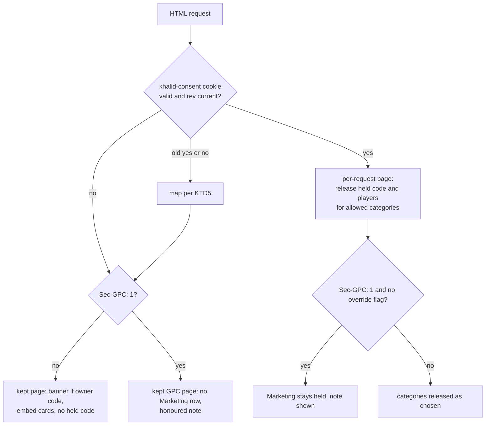
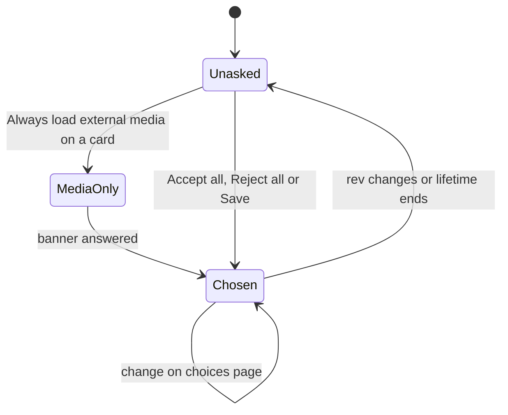

# Built-in privacy and cookie consent - Plan

## Goal Capsule

- **Objective:** Every Khalid site, with no setup, treats its readers the way EU and US privacy law requires: nothing that tracks a reader or stores data on their device runs until they agree, refusing takes one click, a browser's Global Privacy Control signal is honoured, and the owner controls and can prove all of it from the admin.
- **Means:** Extend the existing no-JavaScript consent form and cookie (`docs/adr/0000-consent-is-a-form-and-a-cookie.md`) into category consent, turn embeds into click-to-load placeholders, and generate the privacy page from the site's settings (KTD1, KTD3, KTD6, KTD13).
- **Authority:** Product behaviour is owned by the R-IDs below. Implementation mechanism is owned by the KTDs. Repo rules in `AGENTS.md`, `FRONTEND.md`, `docs/standards/` and the budgets in `docs/standards/performance.md` override this plan where they conflict, except the admin-mockup approval step that U8 updates (KTD14).
- **Stop conditions:** Stop and report if U1 frees less than 60 KB, if any later unit would push the binary over budget, if any page-weight or Lighthouse budget would have to be raised, or if research during implementation shows a default in this plan breaks a law the plan claims to meet.
- **Execution profile:** Rust and template changes across `khalid-core`, `khalid-server`, `khalid`, `khalid-content`, `khalid-render`, `khalid-seo`, `khalid-db`, `khalid-api`, `khalid-newsletter` and `khalid-theme`, plus the React admin. Builds and tests run in CI and on the build box, never on a laptop.
- **Who finishes:** the Khalid CTO session and its helpers, in the unit order below, each unit as its own PR with auto-merge. Each PR states its change to the binary size.

---

## Product Contract

### Summary

Khalid gets a built-in consent manager that is on for every site. It holds every non-essential owner script and every third-party embed until the reader agrees, with five fixed categories, Accept all and Reject all of equal weight, a "Your privacy choices" link on every page, and Global Privacy Control honoured. Embeds ask for themselves with a click-to-load card. The admin gets a Privacy screen to tag scripts, set the consent lifetime, view consent proof and fill in the privacy page, which Khalid writes from the site's real settings.

### Problem Frame

Khalid's own visitor counts set no cookies, and its fonts, share images and search are first party. But three gaps leave a default site out of step with the law. Video and audio embeds load third-party iframes for every reader before any consent (`crates/khalid-content/src/render/media.rs`). The existing banner is a single yes or no that only appears when the owner adds `[code]`, with no categories, no proof of consent and no Global Privacy Control handling. And there is no privacy page, which California's CalOPPA requires of any site that collects an email address. Owners pick Khalid to avoid plugin sprawl, so a consent plugin is not an answer.

### Key Decisions

- **One global EU-grade default, no geolocation.** Opt-in satisfies the EU and UK and is stricter than every US opt-out law; GPC is honoured on top. Governs R1, R2, R5.
- **A banner only for owner scripts; embeds ask for themselves.** A site whose only optional content is embeds shows no banner, because each embed card asks on its own. Governs R3, R12.
- **No IAB TCF; step aside for a certified tool.** Owners who run programmatic ads declare their certified consent tool, and Khalid stops holding their scripts. Governs R3, R17, R24.
- **Proof is the mechanism, not a reader log.** Khalid keeps every version of what readers were shown and daily counts of what they chose, and no per-reader record. Governs R15.
- **Embeds show a provider card, not a fetched thumbnail.** No new network fetch at build or start. Governs R12, R13.

### Requirements

**Defaults and compliance**

- R1. Nothing outside the Necessary category runs, loads or stores data on the reader's device until the reader agrees to its category.
- R2. Consent is asked per category: Necessary (always on, not a toggle), Preferences, Analytics, Marketing and External media. Every optional category starts off.
- R3. The banner appears only when the site has owner code in a non-Necessary category, and never when the owner declared an external certified consent tool.
- R4. A choice lasts 6 months by default, at most 13, and the reader is asked again when the categories, the vendors or the lifetime change.
- R5. A request carrying Global Privacy Control turns Marketing off and keeps it off, and the page says the signal was honoured.
- R6. A reader can withdraw or change consent at any time, as easily as they gave it.
- R24. An owner can declare an owner script as one that "sets no cookie and tracks no one", which puts it in Necessary; the privacy page lists every such script by name.

**Reader experience**

- R7. Every page in every template has a "Your privacy choices" link that opens the choices page.
- R8. The banner's first layer has Accept all, Reject all and Choose, with Accept all and Reject all equal in size, weight and style.
- R9. In server mode, banner, choices page and embed cards work with scripts off; in both modes they work by keyboard and with a screen reader, in English and German, with owner text overrides per language.
- R10. Showing the banner causes no layout shift and does not cover content needed to read the page.
- R11. Crawlers get the same page as a new reader, with no gated content.

**Embeds**

- R12. Each third-party embed shows a provider card with a load button until External media is allowed; the reader can load one embed once or allow External media for the site.
- R13. Feeds, newsletter emails, `llms.txt` and markdown copies carry the embed's title and a link instead of an iframe, and video search data (`VideoObject`, the video sitemap) stays unchanged.

**Static mode**

- R14. A static site supports the banner, categories and embed cards with scripts on; with scripts off nothing optional ever loads, embeds show as links, and there is no consent to change.

**Proof**

- R15. Khalid keeps every version of the banner and category text, categories and vendors readers were shown, with the dates each was in force, and in server mode daily counts of choices per category, with no IP address or reader identifier stored.

**Admin control**

- R17. The admin has a Privacy screen to set categories' text, tag each owner script with a category, set the lifetime, choose the GPC behaviour, declare an external certified consent tool, and enter the owner's contact details.
- R18. The admin shows consent proof: the settings history, daily counts per category, and an export.
- R19. Every privacy setting is reachable through the Admin API, the CLI and MCP, as every other setting is.

**Privacy page**

- R20. Khalid publishes a privacy page at `<mount>privacy/` written from the site's real settings: purposes, cookies with names and lifetimes, vendors, comment, newsletter and form data, retention, reader rights, GPC handling and the owner's contact details.
- R21. An owner page at `content/<language>/pages/privacy.md` replaces the generated page, and can include the generated facts with a `::privacy-facts` directive.

**Performance**

- R22. The release binary stays under its size budget, and every template stays within its page-weight, stylesheet, font, JavaScript and Lighthouse budgets.
- R23. A reader who has not answered still gets a kept page with its ETag and Brotli copy, whether or not their browser sends GPC.

### Acceptance Examples

- AE1. Covers R1, R12. **Given** a server-mode site with a YouTube embed and a Google tag in `[code]`, **when** a new reader loads a post with scripts on, **then** the network log shows no request to any host but the site.
- AE2. Covers R5, R23. **Given** the same site, **when** a reader with no cookie sends `Sec-GPC: 1`, **then** the banner has no Marketing row, says the signal was honoured, the page has an ETag, and Accept all never turns Marketing on.
- AE3. Covers R4. **Given** a reader who chose Analytics only, **when** the owner adds a Marketing script, **then** the next page asks again; a wording change alone does not.
- AE4. Covers R3. **Given** a site with no `[code]` and no embeds, **when** any page loads, **then** no banner appears and the footer link still opens the choices page.
- AE5. Covers R14. **Given** a static site with an embed, **when** a reader with scripts off loads the post, **then** the embed is a link, and no third-party request is made.
- AE7. Covers R3, R12. **Given** a site with embeds and no owner code, **when** a new reader loads a post, **then** no banner appears and the embed card loads the player only after the reader presses its button.
- AE8. Covers R24. **Given** an owner script declared as setting no cookie, **when** a new reader loads a page, **then** the script runs, no banner appears, and the privacy page names the script.

### Success Criteria

- A network capture of every showcase demo, in both modes, scripts on and off, with no consent, shows zero third-party requests.
- Rejecting everything takes one click from the first page.
- The binary and every page budget pass CI with no budget raised.

### Scope Boundaries

- Considered and not built: geolocation and region-specific banners (privacy cost, static mode cannot do it; evidence that would change it: owners losing material revenue from opt-in in the US).
- Considered and not built: IAB TCF (only programmatic ad sites need it, and they must use a Google-certified tool).
- Considered and not built: a cookie scanner (Khalid knows every script and embed it writes, so a declared list is complete and exact).
- Considered and not built: treating GPC as Reject all by default (GPC is a sale and share signal in US law; an admin switch offers the stricter reading).
- Considered and not built: per-reader consent records (an anonymous id proves little beyond the versioned settings and counts, and adds stored reader data; evidence that would change it: a regulator asking a Khalid owner for per-reader proof).
- Considered and not built: an embed mode that loads players directly (it breaks R1).

#### Deferred to Follow-Up Work

- Self-hosted thumbnails on embed cards, fetched through `khalid-outbound` outside the render.
- Banner and privacy page text in languages other than English and German.
- A US-style opt-out mode for non-EU readers.
- Imprint (Impressum) page for German sites.

### Sources

- Research dossiers summarized in this plan's KTDs: EDPB Guidelines 2/2023, CNIL cookie guidance (6-month choice lifetime), CCPA regulations §7025 (GPC and "honoured" display), the state universal opt-out laws in force in 2026, GDPR art. 13, CalOPPA. Items marked unverified in that research (exact CPPA wording after the November 2026 board meeting, the UK analytics exception, youtube-nocookie storage behaviour) must be checked before the policy text ships (U9).
- Code: `docs/adr/0000-consent-is-a-form-and-a-cookie.md`, `crates/khalid-core/src/site_code.rs`, `crates/khalid-server/src/consent.rs`, `crates/khalid/src/page_code.rs`, `crates/khalid/src/consent_route.rs`, `crates/khalid-content/src/render/media.rs`, `crates/khalid-content/src/embed.rs` (`EMBED_PROVIDERS`), `crates/khalid-seo/src/video.rs`, `crates/khalid-content/src/directive/names.rs`.

---

## Planning Contract

### Key Technical Decisions

- KTD1. **Category consent extends the existing form and cookie.** The banner stays a plain form posted to `<mount>_consent/`, answered with a 303 and a first-party cookie, so it keeps working with scripts off in server mode; the cookie value and page marks gain categories (KTD3, KTD4).
- KTD2. **Five fixed categories.** Owners tag scripts into the four optional ones, or declare a script as setting no cookie (R24), but cannot add categories. Owner scripts with no tag count as Marketing.
- KTD3. **Cookie `khalid-consent` version 2, unsigned.** The value is `2.<rev>.<bits>.<unix-day>.<flags>`. `rev` is a short hash of the non-empty categories, their vendors and the lifetime, where External media's vendors are always the fixed `EMBED_PROVIDERS` list, so publishing content never changes it. `bits` holds one bit per category. `flags` records "Marketing allowed despite GPC" and "answered only External media". The cookie carries no identifier, and a changed value affects only that reader, so it is not signed.
- KTD4. **Two kept pages per URL, filled per answered reader.** Each page is kept twice, for readers without and with `Sec-GPC: 1`, each with its own ETag and Brotli copy and `Vary: accept-encoding, cookie, sec-gpc`. The GPC copy drops the Marketing row and adds the honoured note. A reader with a valid cookie gets a per-request page with `private, no-store`.
- KTD5. **Old cookies.** An old `no` maps to Reject all; an old `yes` maps to no answer, because it never covered categories, so those readers are asked once.
- KTD6. **Embeds become cards with the player inside an inert template.** `media.rs` writes a card naming the provider and saying that loading shares the reader's data with it, a "Load media" button, an "Always load external media" button, a link to the provider, and the iframe inside a `<template>` between `external-media` marks, as the change-choice form already is (`CHOSEN_START`). The server removes the marks and the template wrapper for readers who allowed External media. With scripts on, "Load media" clones the template for that card only. `VideoObject` and the video sitemap read the embed source, not the rendered HTML, so they stay.
- KTD7. **Static mode uses a small script.** A static host cannot read a cookie, so the banner and cards are driven by a script of at most 2 KB compressed that writes the cookie, swaps held `type="text/plain"` scripts and clones card templates. Without scripts, nothing optional loads. This supersedes the static refusal in the consent ADR.
- KTD8. **Proof is versioned settings plus daily counts.** A settings-version row is keyed by a hash of everything shown (banner and category text in each language, categories, vendors, lifetime), so a wording change adds a version without re-asking. A count row holds day, version and one counter per category choice. Counting is rate-limited per address in memory with the existing `RateLimits`, and no address is stored. A failed write never blocks the reader.
- KTD9. **GPC.** Server mode reads `Sec-GPC: 1`, static mode reads `navigator.globalPrivacyControl`. Marketing is off and locked unless the reader turns it on explicitly on the choices page, which sets the GPC flag. An admin switch treats GPC as Reject all. `/.well-known/gpc.json` is served in both modes.
- KTD10. **Banner and choices page are templates.** `consent.html` and `privacy-choices.html` live in `crates/khalid-render/templates/`, inside the Brotli archive; `page_code.rs` only splices. The banner sits in the document flow right after the skip link, with no fixed positioning, so it takes its height in the HTML and never overlays content. The choices page is a built-in GET route at `<mount>privacy-choices/`.
- KTD11. **Make room before adding.** U1 moves the shared CSS, `reader.js` and the strings into the existing Brotli archive, freeing about 90 KB of binary, measured with `scripts/perf.sh`. New cold code goes into `opt-level "z"` crates.
- KTD12. **Settings follow the `[seo]` pattern.** A `[privacy]` table in `site.toml`, typed in `crates/khalid-core/src/privacy_settings.rs`, edited through `PUT /settings/` as a JSON part like `site_settings/seo.rs`. `[code]` becomes a list of entries with a category limited to Preferences, Analytics, Marketing or `no-tracking` (R24).
- KTD13. **The privacy page is generated, the owner's page wins.** A built-in route renders `privacy.html` from settings; an owner page at the same slug replaces it and can use the `::privacy-facts` directive, added to the directive allowlist. Owner markdown is never evaluated as a template. Missing contact details are reported in the admin Privacy screen and by `khalid doctor` and `khalid build`, never on the public page.
- KTD14. **The admin mockup is shown, not waited on.** The founder wrote on 6 November 2026 "stop asking me for the permissions" and on 7 November "no more yes game". U8 makes the mockup first and records this rule in `CLAUDE.md` and `docs/standards/typescript.md` in the same PR.
- KTD15. **External certified tool.** When declared, Khalid writes owner code unheld, shows no banner, keeps embed cards, and names the tool on the privacy page.

### High-Level Technical Design

Server request path for an HTML page:

Consent lifecycle for one reader:

### Assumptions

These were inferred without the owner's confirmation. Each is the default an implementer uses unless told otherwise.

- The banner and the choices page are written in plain language in English and German only for this release.
- The stylesheet budget is whatever `docs/standards/performance.md` states when the unit lands.
- Daily counts are kept for 25 months, and settings versions are kept for as long as the site exists.

### Sequencing

U1 first, since every later unit adds bytes. U2 and U3 next, since everything reads the settings and the cookie. U4, U5, U6 and U7 can run in parallel after U3. U8 follows U2. U9 follows U2 and U5. U11 follows U7 and U8. U10 is last.

---

## Implementation Units

| U-ID | Title | Key files | Depends on |
|---|---|---|---|
| U1 | Make room in the binary | `crates/khalid-render/build.rs`, `src/stylesheet.rs`, `src/script.rs`, `src/strings.rs` | none |
| U2 | Privacy settings model | `crates/khalid-core/src/privacy_settings.rs`, `site_code.rs`, `config.rs` | U1 |
| U3 | Consent cookie v2 and server flow | `crates/khalid-server/src/consent.rs`, `respond.rs`, `crates/khalid/src/consent_route.rs` | U2 |
| U4 | Banner, choices page and footer link | `crates/khalid-render/templates/consent.html`, `privacy-choices.html`, `base.html` | U3 |
| U5 | Click-to-load embeds | `crates/khalid-content/src/render/media.rs`, `crates/khalid-seo/src/feed_*.rs` | U3 |
| U6 | Static mode consent | `crates/khalid/src/build.rs`, `crates/khalid-render/assets/consent.js` | U3 |
| U7 | Consent proof storage | `crates/khalid-db/migrations/0030_consent_proof.sql`, `src/consent_proof_table.rs` | U3 |
| U8 | Admin Privacy screen and API | `crates/khalid/src/site_settings/privacy.rs`, `admin/src/privacy/` | U2 |
| U9 | Generated privacy page | `crates/khalid-render/templates/privacy.html`, `crates/khalid/src/privacy_page.rs` | U2, U5 |
| U11 | Consent proof in the admin | `crates/khalid-api/src/admin_consent.rs`, `admin/src/privacy/Proof.tsx` | U7, U8 |
| U10 | Showcase, docs and end-to-end proof | `fixtures/showcase-publications/`, `docs/privacy/`, `docs/adr/` | U4 to U9, U11 |

### U1. Make room in the binary

- **Goal:** Free about 90 KB of binary by moving shared CSS, `reader.js` and the strings into the existing Brotli archive.
- **Requirements:** R22. KTD11.
- **Dependencies:** none.
- **Files:** `crates/khalid-render/build.rs`, `crates/khalid-render/src/stylesheet.rs`, `crates/khalid-render/src/script.rs`, `crates/khalid-render/src/strings.rs`, `crates/khalid-render/tests/assets.rs`, `perf/baseline.json`, `docs/standards/performance.md`.
- **Approach:**
  1. Add the five shared CSS files, `reader.js` and every `strings/*.toml` to the archive `build.rs` already writes.
  2. Decode once at start into the same in-memory form the code uses today.
  3. Record the binary size, the cold first byte and idle memory before and after.
- **Patterns to follow:** `crates/khalid-render/src/templates.rs` (archive and index), `crates/khalid-theme/build.rs` (`PackText`).
- **Execution note:** Performance change; ship only with the before and after numbers in the PR.
- **Test scenarios:**
  - The stylesheet built for every pack is byte-identical before and after.
  - `reader.js` served to a reader is byte-identical before and after.
  - Every string key in `en.toml` and `de.toml` resolves to the same text.
  - A missing locale still falls back to English.
- **Verification:** binary size drops by at least 60 KB; cold first byte stays under its 100 ms budget.

### U2. Privacy settings model

- **Goal:** A typed `[privacy]` table and category-tagged `[code]` that every later unit reads.
- **Requirements:** R2, R3, R4, R9, R17, R24. KTD2, KTD3, KTD12, KTD15.
- **Dependencies:** U1.
- **Files:** `crates/khalid-core/src/privacy_settings.rs` (new), `crates/khalid-core/src/site_code.rs`, `crates/khalid-core/src/config.rs`, `crates/khalid-core/src/lib.rs`, `crates/khalid-core/tests/privacy_settings.rs` (new), `crates/khalid-core/tests/site_code.rs`.
- **Approach:**
  1. `[privacy]` holds lifetime in months (default 6, 1 to 13), GPC mode (`marketing` or `reject-all`), counts on or off (server mode only), the external certified tool's name if declared, per-language text overrides, and the owner's contact details.
  2. `[code]` becomes a list of entries, each with head or body code, a category (Preferences, Analytics, Marketing or `no-tracking`) and an optional vendor name and policy link. The old single-table form still parses: `consent = "ask"` becomes one Marketing entry and `consent = "not-needed"` one `no-tracking` entry.
  3. A `mistake(mode)` check refuses counts in static mode and a lifetime outside 1 to 13, with the fix in the message.
  4. `rev` (KTD3) and the settings-version hash (KTD8) are computed here.
- **Patterns to follow:** `crates/khalid-core/src/visitor_log_settings.rs`, `crates/khalid-core/src/seo_settings.rs`, `tables_mistake` in `config.rs`. Keep `config.rs` under 600 lines by putting the new checks in the new file.
- **Test scenarios:**
  - An empty `site.toml` gives lifetime 6, GPC mode `marketing`, counts on, no external tool.
  - Lifetime 14 is refused with a message naming the 1 to 13 range.
  - The old `[code]` with `consent = "ask"` parses into one Marketing entry with the same code.
  - The old `consent = "not-needed"` parses into one `no-tracking` entry.
  - A `[code]` entry with category `necessary` is refused, naming the allowed values.
  - `rev` is unchanged when only the banner wording changes, and the settings-version hash changes.
  - `rev` changes when a vendor is added or the lifetime changes.
  - `rev` is the same before and after a post with a new embed provider is published.
  - Static mode with counts on is refused at start.

### U3. Consent cookie v2 and server flow

- **Goal:** The server reads and writes category consent, honours GPC and fills each page for the reader.
- **Requirements:** R1, R3, R4, R5, R6, R11, R23. KTD1, KTD3, KTD4, KTD5, KTD9, KTD15.
- **Dependencies:** U2.
- **Files:** `crates/khalid-server/src/consent.rs`, `crates/khalid-server/src/respond.rs`, `crates/khalid/src/consent_route.rs`, `crates/khalid/src/page_code.rs`, the search results page renderer in `crates/khalid` and `crates/khalid-search`, `crates/khalid-server/tests/consent.rs`, `crates/khalid-server/tests/consent_page.rs`, `crates/khalid/tests/serve_consent.rs`, `docs/adr/0000-consent-has-categories.md` (new, supersedes the consent ADR).
- **Approach:**
  1. Replace `Choice` with a consent value holding bits, rev, day and flags, parsed per KTD3, mapping old values per KTD5.
  2. The form route accepts `accept-all`, `reject-all`, `save` with per-category fields, and `allow-external-media`, which sets only External media and the "answered only External media" flag so the banner still shows. It keeps the `Sec-Fetch-Site` check and the 2 KB limit and sets the cookie for the configured lifetime.
  3. The 303 returns to the page named in a checked same-site `back` field, with a one-line saved notice in a `role="status"` region and a link to the choices page; Save on the choices page returns to the choices page.
  4. Use the consent-aware router whenever the site has owner code or embeds, not only when `[code]` waits.
  5. Keep two copies of each page per KTD4, and fill marks per category for answered readers. With an external tool declared, owner code is written unheld (KTD15).
  6. Serve `/.well-known/gpc.json`.
  7. Apply the same filling to the search results page.
- **Patterns to follow:** the existing marks and fail-safe cut in `consent.rs`, the route shape in `consent_route.rs`.
- **Execution note:** Start with failing tests for the GPC kept copy and the old-cookie mapping.
- **Test scenarios:**
  - Covers AE2. No cookie and `Sec-GPC: 1` gives the GPC kept copy with an ETag, a Brotli copy, no Marketing row and the honoured note.
  - No cookie and no GPC gives the plain kept copy with `Vary` including `sec-gpc`.
  - Accept all with `Sec-GPC: 1` sets every bit but Marketing.
  - Turning Marketing on from the choices page under GPC sets the override flag and releases Marketing code.
  - `allow-external-media` from a reader with no cookie releases players and still shows the banner.
  - Covers AE3. A cookie with an old rev gives the banner again.
  - An old `no` cookie gives a Reject all page and an old `yes` gives the banner.
  - A cross-site POST gets 403, a body over 2 KB gets 413, and a `back` path outside the mount returns to the home page.
  - An embed-only site still releases players for a reader who allowed External media.
  - With an external tool declared, owner code is in the page unheld and no banner appears.
  - The search results page carries the same banner marks as a post page.
  - A crawler user agent with no cookie gets the plain kept copy.

### U4. Banner, choices page and footer link

- **Goal:** Readers see a compliant banner, a full choices page and a footer link on every page of every template.
- **Requirements:** R2, R6, R7, R8, R9, R10. KTD10.
- **Dependencies:** U3.
- **Files:** `crates/khalid-render/templates/consent.html` (new), `crates/khalid-render/templates/privacy-choices.html` (new), `crates/khalid-render/templates/base.html`, `crates/khalid-render/assets/site.css`, `crates/khalid-render/strings/en.toml`, `crates/khalid-render/strings/de.toml`, `crates/khalid/src/privacy_choices_route.rs` (new), `crates/khalid-render/tests/snapshots/`, `crates/khalid/tests/privacy_choices.rs` (new).
- **Approach:**
  1. The banner is a labelled `section` with a heading, a short sentence, a link to the privacy page and three controls, placed in the flow after the skip link (KTD10), with no focus trap. Accept all and Reject all share one class, size and style; Choose is a link styled as a button.
  2. The choices page has one `fieldset` and `legend` per category with its description and vendors, a native checkbox as the switch, every optional switch off until the reader turns it on, Necessary shown as always on, a Save button and the GPC note when the signal is present. Focus is visible on every control.
  3. The footer link goes into the footer nav of `base.html`, next to the sitemap link, so every pack inherits it.
- **Patterns to follow:** the existing `.consent` CSS (token variables only), the built-in `sitemap/` route and footer link.
- **Test scenarios:**
  - A snapshot of the banner and the choices page in English and German.
  - Accept all and Reject all render with the same class and attributes apart from their value.
  - Every optional switch on the choices page is unchecked for a reader with no cookie.
  - The footer link appears on a page of every pack.
  - Covers AE4. A site with no gated content renders no banner, and the footer link still renders.
  - The choices page works with scripts off in server mode: a POST saves, and the next page shows the saved notice.
  - An accessibility check finds no errors on the banner and the choices page, and the tab order is skip link, banner, then page.
  - The layout check shows no overlap and CLS 0 with the banner on every pack at 390, 768, 1440 and 2000 px.

### U5. Click-to-load embeds

- **Goal:** No third-party embed loads before External media is allowed, and no text output carries an iframe.
- **Requirements:** R1, R12, R13. KTD6.
- **Dependencies:** U3.
- **Files:** `crates/khalid-content/src/render/media.rs`, `crates/khalid-content/src/embed.rs`, `crates/khalid-seo/src/feed_rss.rs`, `crates/khalid-seo/src/feed_atom.rs`, `crates/khalid-seo/src/feed_json.rs`, the `llms.txt` and markdown copy writers in `crates/khalid-seo`, `crates/khalid-newsletter/src/` (email body), `crates/khalid-theme/packs/channel/post.html`, `crates/khalid-render/assets/reader.js`, `crates/khalid-render/assets/site.css`, `crates/khalid-content/tests/embeds.rs`, `crates/khalid-seo/tests/video_kept.rs` (new).
- **Approach:**
  1. Render the card per KTD6 in a box with the player's aspect ratio, so loading causes no shift.
  2. With scripts on, "Load media" clones the template and moves focus to the player.
  3. With scripts off, "Load media" is the link to the provider and "Always load external media" is a form posting `allow-external-media`.
  4. Feeds, newsletter emails, `llms.txt` and markdown copies use the embed title and link.
  5. Update the `channel` pack's video check to look for the new card.
- **Patterns to follow:** existing lazy iframe output in `media.rs`, the inert-template marks in `crates/khalid-server/src/consent.rs`.
- **Test scenarios:**
  - Covers AE1. The kept page for a post with a YouTube embed contains no live `<iframe` outside a `template`.
  - A reader with External media allowed gets the iframe.
  - The RSS, Atom and JSON feeds, `llms.txt` and the markdown copy contain the title and link and no iframe.
  - `VideoObject` and the video sitemap entry are byte-identical before and after.
  - An audio embed's card says "Load media", not video.

### U6. Static mode consent

- **Goal:** Static sites get categories, a banner and embed cards with scripts on, and fail closed with scripts off.
- **Requirements:** R1, R5, R14. KTD7, KTD9.
- **Dependencies:** U3.
- **Files:** `crates/khalid/src/build.rs`, `crates/khalid/src/page_code.rs`, `crates/khalid-render/assets/consent.js` (new), `crates/khalid-core/src/config.rs`, `crates/khalid/tests/build_consent.rs` (new).
- **Approach:**
  1. Static pages carry held owner code as `type="text/plain"` scripts tagged with their category, the banner hidden until `consent.js` shows it, and the same embed cards.
  2. `consent.js`, at most 2 KB compressed and loaded only on sites with owner code or embeds, shows the banner, writes the cookie per KTD3, swaps held scripts, clones card templates and reads `navigator.globalPrivacyControl`.
  3. The static choices page works with scripts on; with scripts off it says nothing optional is loaded.
  4. Write `/.well-known/gpc.json` into the build output.
  5. Remove the static refusal of code that waits for consent.
- **Patterns to follow:** `PageCode` static branch, `reader.js` loading.
- **Test scenarios:**
  - A static build of a site with gated code emits held scripts as `text/plain`.
  - Covers AE5. With scripts off a static post with an embed shows the link and makes no third-party request.
  - `consent.js` is at most 2 KB compressed and absent on a site with no owner code and no embeds.
  - With `globalPrivacyControl` true, Marketing stays held after Accept all.
  - The build output contains `/.well-known/gpc.json`.

### U7. Consent proof storage

- **Goal:** Proof of what readers were shown and what they chose, with no reader identifier.
- **Requirements:** R15. KTD8.
- **Dependencies:** U3.
- **Files:** `crates/khalid-db/migrations/0030_consent_proof.sql` (new), `crates/khalid-db/src/consent_proof_table.rs` (new), `crates/khalid-db/README.md`, `crates/khalid/src/consent_route.rs`, `crates/khalid-db/tests/consent_proof.rs` (new).
- **Approach:**
  1. Two `STRICT` tables: settings versions (hash, shown text and settings as JSON, first and last day in force) and daily counts (day, version, one counter per category choice). Both listed as `visitor` in the README.
  2. The consent route gets the store, rate-limits counting per address in memory, and adds to the day's counters off the request path; a failed write is logged and never blocks the answer.
  3. Prune counts older than 25 months.
- **Patterns to follow:** `0021_audit_log.sql`, `audit_table.rs`, age pruning in `visitor_log_table.rs`, `RateLimits` in `khalid-forms`.
- **Test scenarios:**
  - A choice adds one to the right counters for the current version, and no table has an address or identifier column.
  - The same settings reuse one version row; a wording change adds one.
  - A burst of choices from one address over the limit adds nothing more.
  - Counts older than 25 months are pruned.
  - A database write failure still returns the 303 with the cookie.
  - The rebuild test passes with the new tables listed.

### U8. Admin Privacy screen and API

- **Goal:** Owners control every privacy setting from the admin, API, CLI and MCP.
- **Requirements:** R17, R19, R24. KTD12, KTD14.
- **Dependencies:** U2.
- **Files:** `crates/khalid/src/site_settings/privacy.rs` (new), `crates/khalid-api/src/resources/admin_settings.rs`, `crates/khalid-api/src/admin_site_settings.rs`, `docs/design/admin-mockups/privacy.html` (new), `admin/src/privacy/` (new), `admin/src/routes/router.tsx`, `admin/src/components/navigation.ts`, `CLAUDE.md`, `docs/standards/typescript.md`, `crates/khalid-api/tests/privacy_settings.rs` (new).
- **Approach:**
  1. Make the mockup first, matching `settings.html` and `seo-tools.html`, light theme, and record the ship-then-show rule (KTD14).
  2. `privacy` travels as a JSON part of `PUT /settings/`, like `seo`, with OpenAPI entries, so the SDK, CLI and MCP get it.
  3. The screen has tabs: Settings (lifetime, GPC mode, external tool, counts), Scripts (each entry with a category picker, and an untagged entry labelled "counts as Marketing"), Text (banner and category text per language) and Contact (owner details, with a warning when they are missing).
  4. Empty states cover no scripts and static mode, and a save shows the restart notice.
- **Patterns to follow:** `site_settings/seo.rs`, `admin/src/seo/*.tsx`.
- **Test scenarios:**
  - `PUT /settings/` with a privacy part writes `[privacy]` and returns `restart_needed`.
  - A lifetime of 14 returns 422 naming the field.
  - A stale `updated_at` returns 409.
  - A key without `settings:write` gets 403.
  - Covers AE8. Tagging a script `no-tracking` saves and shows after reload.
  - Missing contact details show the warning on the Contact tab.

### U9. Generated privacy page

- **Goal:** Every site has an accurate privacy page from day one.
- **Requirements:** R20, R21. KTD13.
- **Dependencies:** U2, U5.
- **Files:** `crates/khalid-render/templates/privacy.html` (new), `crates/khalid/src/privacy_page.rs` (new), `crates/khalid-content/src/directive/names.rs`, the `privacy-facts` directive renderer in `crates/khalid-content/src/directive/`, `crates/khalid/src/doctor.rs`, `crates/khalid-render/strings/en.toml`, `crates/khalid-render/strings/de.toml`, `crates/khalid/tests/privacy_page.rs` (new).
- **Approach:**
  1. Sections follow GDPR art. 13 and CalOPPA: who runs the site, what is collected and why, cookies with names and lifetimes, vendors per category, `no-tracking` scripts by name, comments, newsletter and form data, retention, reader rights and how to use them, GPC handling, an external tool if declared, how to complain, and when the page last changed.
  2. A linked list of sections opens the page; each section starts with a one-sentence summary; cookie and vendor tables scroll in their own box on a phone.
  3. Facts come from settings and enabled features, so the page changes when they do.
  4. Add `privacy-facts` to the directive allowlist for owner pages.
  5. `khalid doctor` and `khalid build` warn when contact details are missing.
  6. Verify the research items marked unverified before the text is final.
- **Patterns to follow:** the `sitemap/` built-in route, `page.html`, existing directives in `crates/khalid-content/src/directive/`.
- **Test scenarios:**
  - A site with comments and newsletter on lists both with their data and retention.
  - Adding a Marketing vendor adds it to the page and changes "last changed".
  - An owner `privacy.md` replaces the generated page, and its `::privacy-facts` directive renders the facts.
  - Template syntax in an owner page renders as text.
  - Missing contact details make `khalid doctor` warn, and the public page shows no notice.

### U11. Consent proof in the admin

- **Goal:** Owners can show a regulator what readers saw and chose.
- **Requirements:** R18. KTD8.
- **Dependencies:** U7, U8.
- **Files:** `crates/khalid-api/src/admin_consent.rs` (new), `admin/src/privacy/Proof.tsx` (new), `crates/khalid-api/tests/admin_consent.rs` (new).
- **Approach:**
  1. Read-only routes return settings versions with their dates and daily counts per category for a date range, with OpenAPI entries.
  2. A Proof tab shows a weekly table, one column per category, with an empty state "No choices recorded yet", the settings history, and a CSV export, reusing the analytics date-range control.
- **Patterns to follow:** `admin_audit.rs` and `AuditLog.tsx`, the analytics screen.
- **Test scenarios:**
  - The counts route returns totals per category for a range.
  - The versions route returns every version with its first and last day.
  - The export contains the same totals as the table.
  - A static-mode site shows the settings history and an empty counts state.

### U10. Showcase, docs and end-to-end proof

- **Goal:** Prove the defaults on real templates and document them for owners.
- **Requirements:** R1, R10, R22.
- **Dependencies:** U4, U5, U6, U7, U8, U9, U11.
- **Files:** `fixtures/showcase-publications/` (one demo with an embed and a tagged script), `scripts/demo-check/` (network capture check), `docs/privacy/consent.md` (new), `crates/khalid-core/src/visitor_log_settings.rs` (rustdoc pointer), `changelog.d/privacy-consent.md` (new), `docs/adr/0000-consent-has-categories.md`.
- **Approach:**
  1. Add a demo-check step that loads each showcase page without consent, scripts on and off, and fails on any third-party request.
  2. Write the owner guide in plain language: what Khalid does by default, what each setting does, and a note that the generated page is not legal advice.
  3. Fix the rustdoc pointer from `docs/privacy/visitor-log.md` to `docs/design/visitor-log.md`.
- **Test scenarios:**
  - The network check fails when an iframe is rendered without consent.
  - Every pack passes the layout, page-weight and Lighthouse checks with the banner showing.
- **Verification:** CI green with no budget changed.

---

## Verification Contract

| Gate | Applies to | Command or check |
|---|---|---|
| Format and lint | every unit | `cargo fmt --all -- --check`, `cargo clippy --workspace --all-targets --all-features -- -D warnings` (CI) |
| Tests | every unit | `cargo nextest run` with the coverage floor (CI), `just check` on the build box |
| Binary size | every unit | CI size step under 31,457,280 bytes; the PR states the unit's change |
| Performance | U1, U3 | `scripts/perf.sh` before and after, numbers in the PR |
| Layout, page weight, Lighthouse | U4, U5, U6, U10 | `scripts/layout-check.sh`, `scripts/page-weight.sh`, the Demo check |
| Scripts off | U4, U5, U6 | the scripts-off CI run |
| Accessibility | U4, U8, U11 | the accessibility check in the layout run and the admin tests |
| Network capture | U5, U6, U10 | the new demo-check step |
| Admin | U8, U11 | admin tests and type check in CI |
| Messages | every unit with text | the messages test: short sentences, no em dash |

## Definition of Done

- Every R-ID is covered by a unit and its tests pass in CI.
- No budget in `docs/standards/performance.md` or CI was raised.
- The new ADR supersedes `docs/adr/0000-consent-is-a-form-and-a-cookie.md`.
- The owner guide and changelog fragment are merged.
- Code from abandoned approaches is removed from the diff.
- Per unit: the Verification Contract gates that name the unit hold, and its test scenarios exist.
