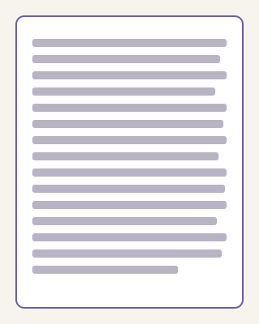
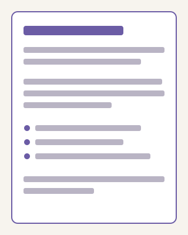

An editing checklist is a short list of checks you run on every post before it goes live, in the same order, every time. Ours has grown out of years of newspaper subbing and client work. It catches the problems a tired writer no longer sees, and it turns a good draft into a post a busy reader can use.

This post is part of [Larkspur's complete course on SEO writing](/blog/seo-writing-guide/). Below is the checklist itself, the tools we use, and the kit we give clients.

## Why a fixed editing checklist beats a careful read

A careful read finds what you happen to notice. A checklist finds what you always miss. Writers miss the same things in their own work again and again: the buried answer, the paragraph that says the same thing twice, the link with vague words.

A fixed order also saves time. You stop deciding what to check and simply check it. Our editors get through a full post in under an hour this way, and the second reader rarely finds anything new.

:::callout
Do not edit straight after writing. Leave the draft overnight if you can. Fresh eyes catch the gaps that tired ones skip.
:::

## The checklist, step by step

::::howto{name="Edit a blog post before it goes live" time="45:00"}
:::step{name="Find the answer"}
Read only the title and the first paragraph. Does a reader in a hurry get the answer? If not, move it up.
:::
:::step{name="Check the headings"}
Read the headings alone, top to bottom. They should tell the whole story. Rewrite any heading that names a topic without saying anything about it.
:::
:::step{name="Cut the repeats"}
Look for paragraphs that make the same point twice. Keep the better one. We usually cut about a fifth of the words here.
:::
:::step{name="Shorten the sentences"}
Split any sentence that runs past two lines. Swap long words for short ones where the meaning stays the same.
:::
:::step{name="Check every claim"}
Every number needs a source or a year. Every strong claim needs a link or an example. If you cannot back it, cut it.
:::
:::step{name="Test the links"}
Click every link. Make sure the link words say where each one goes. Replace any "click here" with the name of the page.
:::
:::step{name="Read it on a phone"}
Long paragraphs and wide tables show up at once on a small screen. Fix what feels cramped.
:::
::::

## Before and after a full edit

The two sketches below show the same draft. On the left, the first draft: one long block that a reader has to dig through. On the right, the edited version, with a heading, short paragraphs and a list.

:::gallery

:::

Nothing new was written between the two. The edit only moved, cut and split what was already there. That is most of what editing is.

## Checks that go beyond the words

A post can read well and still fail on the page. Before we sign off, we check three things outside the text:

- **Images.** Each has a short description of what it shows, for readers who cannot see it.
- **Speed.** Large images slow the page down. Our post on [Core Web Vitals for people who write](/blog/core-web-vitals/) explains what to watch.
- **The date.** If the post updates an older one, the date and a short note on what changed go at the top.

## The tools and the kit we use

A readability checker helps with the sentence step. The one our editors still open daily is Quillmeter, a small checker that flags long sentences and hard words as you type. A readability score is a guide, not a goal. Use it to find the sentences worth a second look, then trust your own judgment.

Clients often ask for our editing checklist as a file they can share with their own writers, so we put it in a kit with our brief template and a calendar sheet. Our review of the checker and the kit itself are on [the page of tools and templates we use](/blog/tools/).

Members can read how we fill in a brief, field by field, in [our content brief template walkthrough](/blog/content-brief-template/).

## When an old post needs the checklist again

The checklist is not only for new posts. When an older post starts to slip in search, we run it again, alongside the extra checks in [our playbook for refreshing posts](/blog/content-refresh/). A fresh edit often does more than new words.

The Plain Language Action and Information Network keeps a useful [plain language checklist](https://www.plainlanguage.gov/resources/checklists/checklist/) that inspired several of our steps. It is worth a look if you want to build your own editing checklist from scratch.

::button{href="/blog/about/" label="Ask us about editing"}
