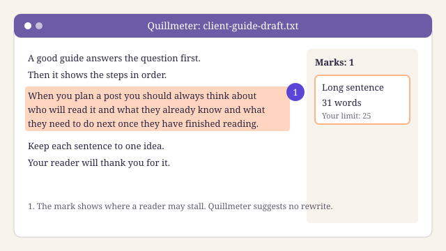
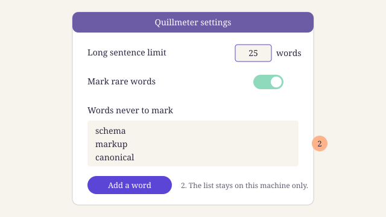

Quillmeter suits editors and solo writers who want a quiet readability checker that marks long sentences and rare words and leaves the fixing to them. Skip it if you want a tool that rewrites for you, or if a whole team must share one set of rules. Our score after six months of daily use: four out of five.

::toc

:::callout
- **What it is:** a small desktop app that checks a draft as you type and works offline.
- **Best at:** marking long sentences and rare words in place, without touching your words.
- **Weakest at:** technical terms, which it flags as problems, and team use, which it does not support.
- **Our score:** [4](/blog/editorial-policy/) out of 5, given the way our editorial policy sets out for every tool we review.
:::

## What it does well

Quillmeter does one job and stays out of the way. You paste a draft or open a file, and it marks two things: sentences that run long, and words most readers rarely meet. It does not suggest new words. It does not score your "tone". It shows you where a reader may stall, and you decide what to do.

That restraint is the main reason we kept it. Tools that rewrite for you tend to flatten a writer's voice, and they make it easy to accept a change you did not read. With Quillmeter the writer stays in charge of every word, which is how we want our editors to work on [the sentence step of our editing checklist](/blog/editing-checklist/).

Three more things stood out in our own use:

- **It is fast.** On the longest guide we edited this year, the marks kept up with our typing. We never waited for a check to finish.
- **It works offline.** We edited two client drafts on a train with no signal, and every check still ran. Nothing leaves your machine, which matters when a client has not yet published.
- **The limits are yours to set.** You choose how many words make a sentence "long". We set ours at twenty-five words, and Quillmeter marked exactly the sentences we would have marked by hand.

:::gallery

:::

## Where it falls short

No readability checker is perfect, and Quillmeter has two clear gaps. Each one cost us time on real work.

**It treats technical terms as problems.** On a post about [[glossary:structured-data|structured data]] for a client, Quillmeter marked "schema", "markup" and "canonical" in almost every paragraph. Those are the words a specialist reader expects. You can add words to a personal list so it stops marking them, but you have to do it one word at a time, and the list does not travel with the draft.

**It has no team settings.** Each copy of Quillmeter keeps its own limits and word list. When three of our editors checked the same draft, they saw different marks, because one had set a lower limit for long sentences than the other two. We now keep the settings in a shared note and copy them by hand, which is a workaround, not a fix.

Two smaller points. It reads plain text and common document files, but it cannot check a page straight from a website, so you copy the text out first. And it does not know anything about search: it will not tell you if a heading matches [[glossary:search-intent|what the searcher wants]]. That is fine, as long as you know it is a writing tool and not an SEO tool.

:::proscons
+ Marks long sentences and rare words in place, and never rewrites
+ Fast, even on a long draft
+ Works offline, so drafts stay on your machine
+ You set your own limit for long sentences
- Marks technical terms as rare words, even where the reader expects them
- No shared settings, so a team sees different marks on the same draft
- Cannot check a live web page
:::

## Who Quillmeter is for

Quillmeter fits a writer or editor who already knows what good prose looks like and wants a second pair of eyes for the slips. If you edit other people's drafts every day, it saves you the tedium of counting words in long sentences. If you write alone, it catches the habits you no longer notice.

It fits less well in two cases. A team that needs one shared standard will fight the missing settings. And a writer in a technical field will spend a lot of time teaching it words. If you are still choosing between kinds of tools, start with [our guide to choosing SEO tools for a small team](/blog/choosing-seo-tools/), which puts writing tools beside search tools.

:::callout
**How we review.** Nobody pays to appear in a Larkspur review, and we buy our own copies. We only review tools we have used on real client work for at least three months. We use no affiliate links, so no score here earns us money.
:::

## How we tested it

Dalia Moreno, our tools and reviews editor, used Quillmeter every working day from February to August 2026. Two other editors used it on the same drafts so we could compare their marks.

We ran it on about fifty drafts: most were client work, and a dozen were our own posts. For each draft we wrote down where Quillmeter marked a sentence and whether we changed it. We also counted the marks we ignored, which is how we found the gap with technical terms. We did not run speed tests in a lab: our notes on speed come from ordinary use on a three-year-old laptop.

We judged it on four points: does it find the sentences a good editor would find, does it keep the writer in charge, is it quick enough to leave open all day, and does it fit how a team works. It scored well on the first three and poorly on the last.

If you want a wider view of what to look for in a writing tool, our [short notes on the tools we use](/blog/tools/) cover the rest of our kit, and [our pick of free tools for a small blog](/blog/best-free-seo-tools/) covers the search side.

## The verdict

Quillmeter is the readability checker we open first. It marks long sentences and rare words without taking the pen from the writer, it is quick, and it works anywhere. It loses a point for marking technical words a specialist reader expects, and for having no shared settings. For a solo writer or a careful editor, it earns its place. For a team that needs one standard, wait for team settings.

:::review{item="Quillmeter" type="SoftwareApplication" rating="4" best="5" author="Dalia Moreno"}
A fast, quiet readability checker that marks long sentences and rare words in place and leaves every change to you. It works offline. It loses a point for treating technical terms as problems and for having no team settings.
:::

For the plain-language case behind tools like this, see the guidance on [writing for readers in Google's documentation](https://developers.google.com/search/docs/fundamentals/creating-helpful-content). Good tools help, but the habit of short, clear sentences builds [[e-e-a-t|trust with readers]] on its own.

::newsletter{label="Your email address" button="Get our next tool review"}
